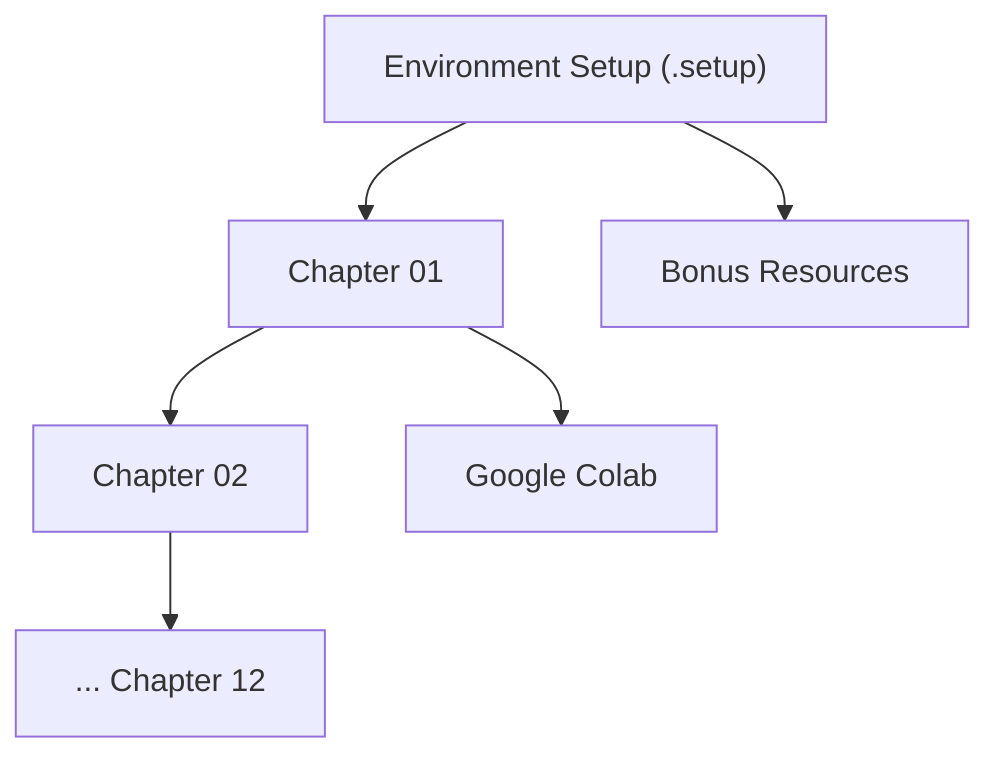

# HandsOnLLM/Hands-On-Large-Language-Models

> Companion code for the book "Hands-On Large Language Models", chapter-by-chapter notebooks for learning LLMs.

## The problem
Understanding tokenization, embeddings, semantic search, RAG and fine-tuning takes runnable examples, not just theory.

## What it actually does
One notebook folder per chapter (12 chapters), a `.setup` folder for the environment (conda, requirements) and a `bonus` folder of visual guides (Mamba, quantization, mixture of experts, reasoning). The notebooks are designed for Google Colab.

## How it is wired


## Trying it
The README documents no command; the environment is described in `.setup`.
```bash
# aucune commande documentée dans le README fourni
```

## Cost and gotchas
Free; the book is paid. A GPU is useful: Colab is the intended route. Last push in April 2026.

## What it is not
Not a tool or a library: the code only makes sense with the book. The README is mostly a collection of reviews.

## Alternatives
None named in the README.

## For you
Adopt it to train yourself or a team: reproducible examples, under Apache-2.0, covering the whole LLM lifecycle.
