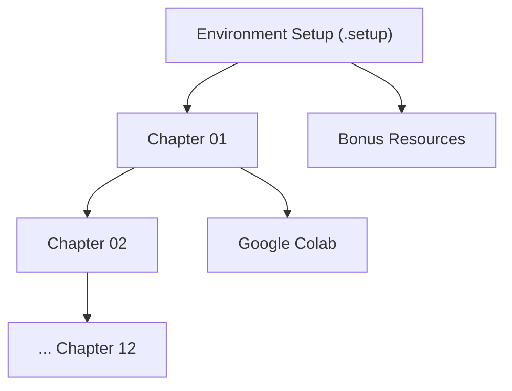

# HandsOnLLM/Hands-On-Large-Language-Models

> Code d'accompagnement du livre « Hands-On Large Language Models », notebooks par chapitre pour apprendre les LLM.

## Le problème
Comprendre tokenisation, embeddings, recherche sémantique, RAG et fine-tuning demande des exemples exécutables, pas seulement de la théorie.

## Ce que ça fait vraiment
Un dossier de notebooks par chapitre (12 chapitres), un dossier `.setup` pour l'environnement (conda, requirements) et un dossier `bonus` de guides visuels (Mamba, quantisation, mixture of experts, raisonnement). Les notebooks sont conçus pour Google Colab.

## Comment c'est branché


## Essayer
Le README ne documente aucune commande ; l'environnement est décrit dans `.setup`.
```bash
# aucune commande documentée dans le README fourni
```

## Coût et pièges
Gratuit ; le livre est payant. Un GPU est utile : Colab est la voie prévue. Dernier push en avril 2026.

## Ce que ce n'est pas
Pas un outil ni une bibliothèque : le code n'a de sens qu'avec le livre. Le README est surtout un recueil d'avis.

## Alternatives
Aucune nommée dans le README.

## Pour toi
À adopter pour te former ou former une équipe : exemples reproductibles, sous Apache-2.0, couvrant tout le cycle des LLM.

