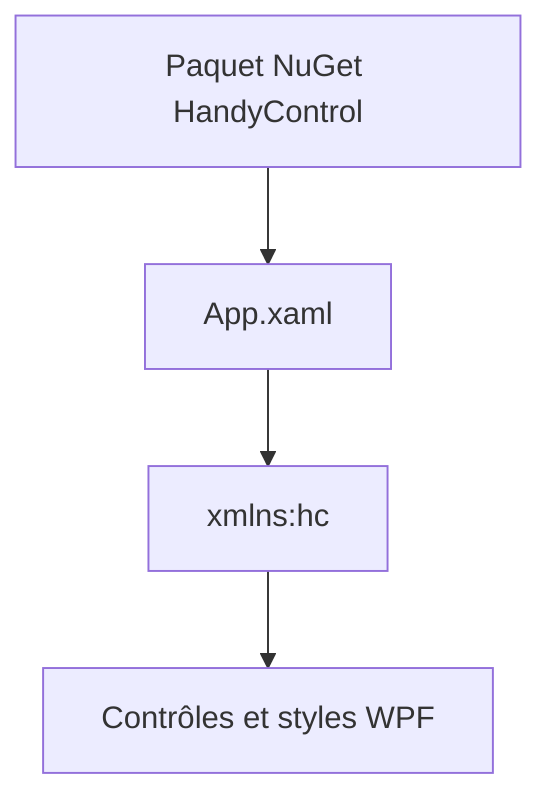

# HandyOrg/HandyControl

> Library of WPF controls and styles for Windows applications, with a dark theme.

## The problem
Standard WPF controls are limited; modern ready-to-use components are missing.

## What it actually does
Installable via NuGet, the library adds dozens of WPF controls: Growl, Drawer, Carousel, styled DataGrid, ColorPicker, StepBar, FlexPanel, etc., as well as styles for the standard controls and a dark theme. You reference an XAML namespace in App.xaml. The README is mostly an image gallery, with little text.

## How it is wired
Simplified diagram based on the sheet, no diagram provided.



## Trying it
```bash
Install-Package HandyControl
```
Then add `xmlns:hc="https://handyorg.github.io/handycontrol"` in the XAML.

## Cost and gotchas
Free. Real need: Windows, .NET and Visual Studio for WPF, which are missing from the prerequisites list. 329 open issues. The README's XAML block is empty in the material provided.

## What it is not
Not a cross-platform or web library: WPF only. Not detailed technical documentation in the README.

## Alternatives
No alternative named in the README.

## For you
Ignore: reserved for Windows desktop interfaces, outside your data / AI / MLOps scope.
