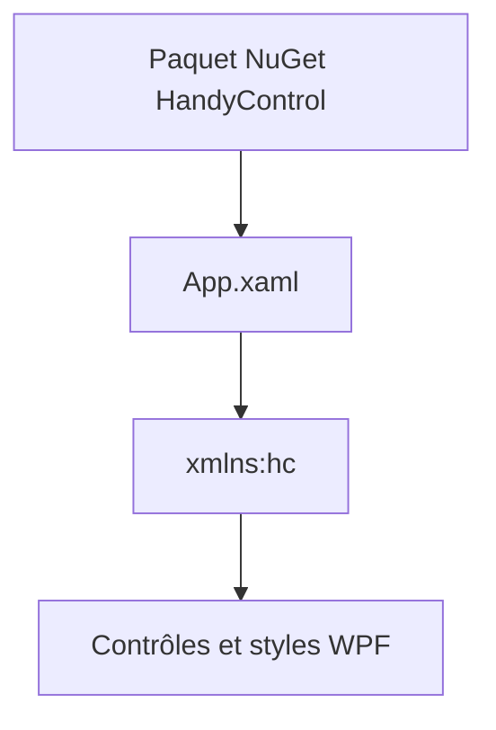

# HandyOrg/HandyControl

> Bibliothèque de contrôles et de styles WPF pour applications Windows, avec thème sombre.

## Le problème
Les contrôles WPF standard sont limités ; il manque des composants modernes prêts à l'emploi.

## Ce que ça fait vraiment
Installable via NuGet, la bibliothèque ajoute des dizaines de contrôles WPF : Growl, Drawer, Carousel, DataGrid stylé, ColorPicker, StepBar, FlexPanel, etc., ainsi que des styles pour les contrôles standards et un thème sombre. On référence un espace de noms XAML dans App.xaml. Le README est surtout une galerie d'images, avec peu de texte.

## Comment c'est branché
Schéma simplifié d'après la fiche, sans diagramme fourni.



## Essayer
```bash
Install-Package HandyControl
```
Puis ajouter `xmlns:hc="https://handyorg.github.io/handycontrol"` dans le XAML.

## Coût et pièges
Gratuit. Besoin réel : Windows, .NET et Visual Studio pour WPF, absents de la liste des prérequis. 329 issues ouvertes. Le bloc XAML du README est vide dans la matière fournie.

## Ce que ce n'est pas
Pas une bibliothèque multiplateforme ni web : uniquement WPF. Pas une doc technique détaillée dans le README.

## Alternatives
Aucune alternative nommée dans le README.

## Pour toi
À ignorer : réservé aux interfaces de bureau Windows, hors de ton périmètre data / IA / MLOps.

