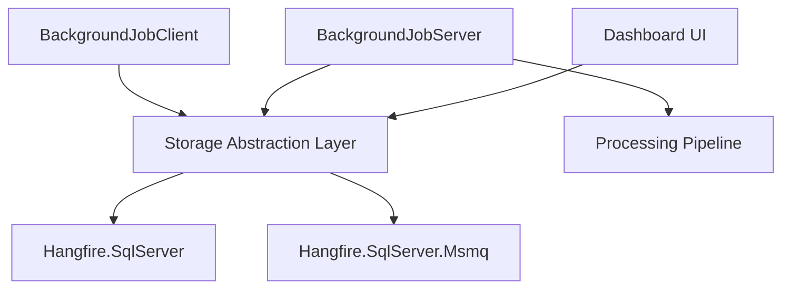

# HangfireIO/Hangfire

> .NET library for running immediate, delayed or recurring background jobs, without a Windows service.

## The problem
Long-running or scheduled tasks block web requests, or force you to write a Windows service or a scheduled task.

## What it actually does
Lets you enqueue (Enqueue), delay (Schedule), repeat via CRON (RecurringJob) or chain (ContinueWith) jobs. Jobs are stored in SQL Server, Redis, SQL Azure or MSMQ; a web dashboard tracks their state.

## How it is wired



## Trying it
```bash
PM> Install-Package Hangfire
build
build pack
```

## Cost and gotchas
Free, but you need storage (SQL Server, for example) and a connection string. GitHub does not identify the license; the README states LGPL v3. Building the repository requires MSMQ and a Windows environment.

## What it is not
Not a data pipeline orchestrator: only background jobs within a .NET application.

## Alternatives
- Resque, Sidekiq, delayed_job, Celery: equivalents cited in other ecosystems (Ruby, Python).

## For you
Ignore: reserved for .NET applications; for background jobs in Python, Celery, cited by the README, is a better fit.
