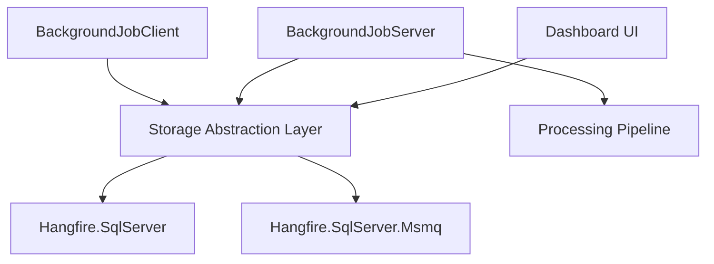

# HangfireIO/Hangfire

> Bibliothèque .NET pour lancer des tâches de fond immédiates, différées ou récurrentes, sans service Windows.

## Le problème
Les tâches longues ou planifiées bloquent les requêtes web, ou obligent à écrire un service Windows ou une tâche planifiée.

## Ce que ça fait vraiment
Permet de mettre en file (Enqueue), de différer (Schedule), de répéter par CRON (RecurringJob) ou d'enchaîner (ContinueWith) des tâches. Les tâches sont stockées dans SQL Server, Redis, SQL Azure ou MSMQ ; un tableau de bord web suit leur état.

## Comment c'est branché



## Essayer
```bash
PM> Install-Package Hangfire
build
build pack
```

## Coût et pièges
Gratuit, mais il faut un stockage (SQL Server, par exemple) et une chaîne de connexion. GitHub n'identifie pas la licence ; le README indique la LGPL v3. Compiler le dépôt exige MSMQ et un environnement Windows.

## Ce que ce n'est pas
Pas un orchestrateur de pipelines de données : seulement des tâches de fond dans une application .NET.

## Alternatives
- Resque, Sidekiq, delayed_job, Celery : équivalents cités dans d'autres écosystèmes (Ruby, Python).

## Pour toi
À ignorer : réservé aux applications .NET ; pour des tâches de fond en Python, Celery, cité par le README, convient mieux.

