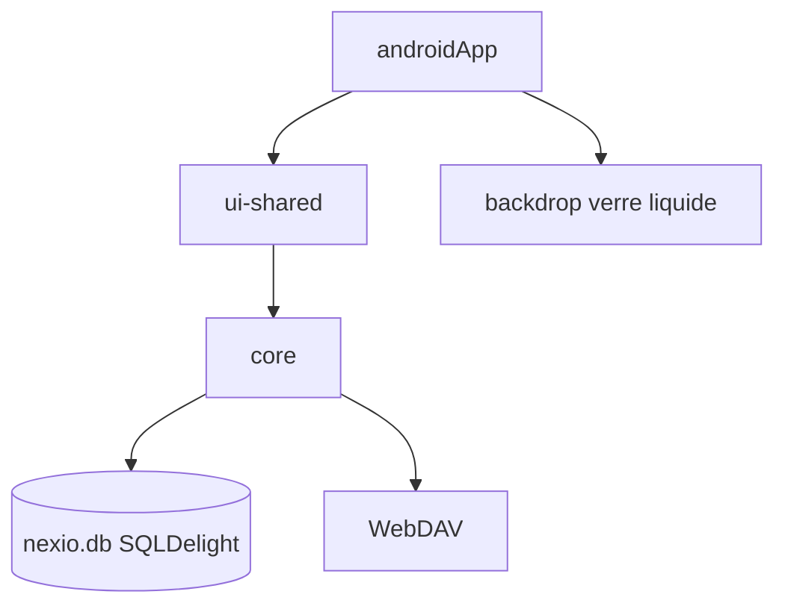

# HaoZai000/NexioSchedule

> School timetable app for Android, with a liquid glass effect and local data.

## The problem
Chinese students want a course timetable with weekly views, reminders and import from the school system.

## What it actually does
Shows a week view and a timeline view, handles multiple timetables, imports from the school portal, AI-generated text, JSON or ICS files, or a share code. Sends reminders, offers widgets and backs up locally or via WebDAV. Data is stored in a SQLite database `nexio.db`.

## How it is wired


## Trying it
```bash
export JAVA_HOME="/Applications/Android Studio.app/Contents/jbr/Contents/Home"
./gradlew :androidApp:assembleDebug
./gradlew :ui-shared:compileKotlinJvm
```

## Cost and gotchas
Free. Android 8.0 or later. Built from source, with Android Studio. Island notifications require Shizuku. README in Chinese; AGPL-3.0 license.

## What it is not
Not an online service: everything stays on the device. Desktop and iOS versions exist in the repository but the README mostly details Android.

## Alternatives
None named in the README.

## For you
Unrelated to data, AI or MLOps: ignore.
