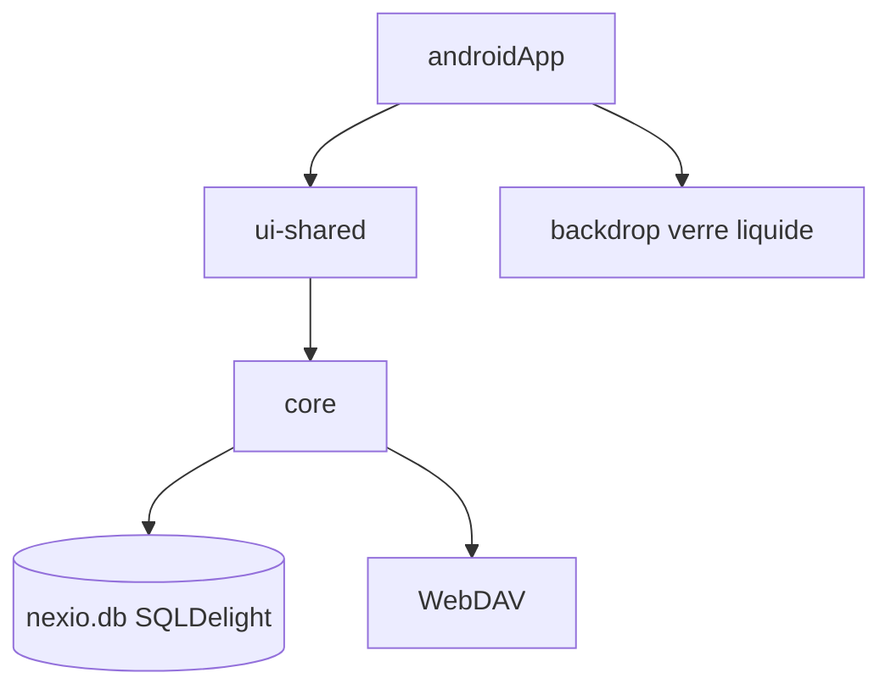

# HaoZai000/NexioSchedule

> Application d'emploi du temps scolaire pour Android, en effet verre liquide, données locales.

## Le problème
Les étudiants chinois veulent un emploi du temps de cours avec vues par semaine, rappels et import depuis le système scolaire.

## Ce que ça fait vraiment
Affiche une vue semaine et une vue chronologique, gère plusieurs emplois du temps, importe depuis le portail scolaire, un texte généré par IA, des fichiers JSON, ICS ou un code de partage. Envoie des rappels, propose des widgets et sauvegarde en local ou par WebDAV. Données dans une base SQLite `nexio.db`.

## Comment c'est branché


## Essayer
```bash
export JAVA_HOME="/Applications/Android Studio.app/Contents/jbr/Contents/Home"
./gradlew :androidApp:assembleDebug
./gradlew :ui-shared:compileKotlinJvm
```

## Coût et pièges
Gratuit. Android 8.0 ou plus. Compilation depuis les sources, avec Android Studio. Les notifications d'îlot demandent Shizuku. README en chinois ; licence AGPL-3.0.

## Ce que ce n'est pas
Pas un service en ligne : tout reste sur l'appareil. Les versions bureau et iOS existent dans le dépôt mais le README détaille surtout Android.

## Alternatives
Aucune nommée dans le README.

## Pour toi
Sans rapport avec data, IA ou MLOps : à ignorer.

