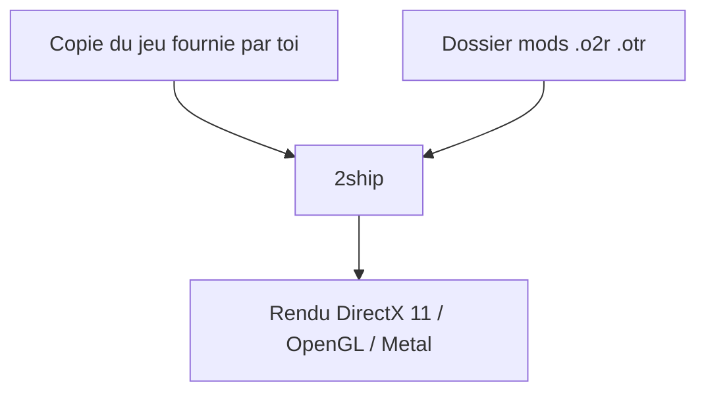

# HarbourMasters/2ship2harkinian

> PC port of a Zelda game on Nintendo 64: you must supply your own copy of the game.

## The problem
Playing this game on PC with modern graphics and advanced settings, without an emulator.

## What it actually does
A program to launch with your own copy of the game. Offers DirectX 11, OpenGL or Metal rendering, keyboard shortcuts, fullscreen, custom assets in `.o2r` or `.otr` format in a `mods` folder, and nightly builds for testing.

## How it is wired
Simplified diagram based on the fiche, no diagram provided.

## Trying it
No command: download from the Releases, extract and run `2ship.exe` (Windows). On Linux: `chmod +x` on the AppImage.

## Cost and gotchas
Free, CC0-1.0. No protected content included: you need a compatible copy, which can be checked on 2ship.equipment. Nightly builds sometimes crash.

## What it is not
Not a game shipped with its assets. Not a professional tool.

## Alternatives
No alternative named in the README.

## For you
Ignore: a video game port, unrelated to data / AI / MLOps work.
