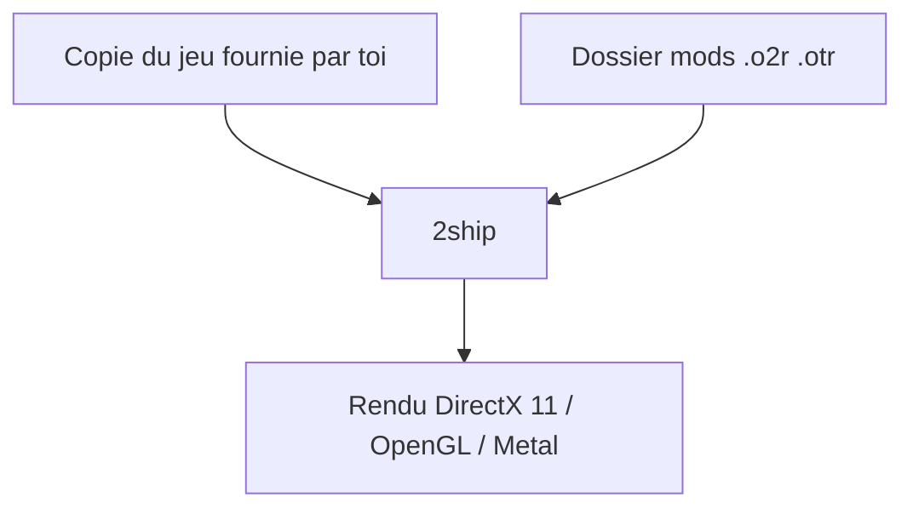

# HarbourMasters/2ship2harkinian

> Portage PC d'un jeu Zelda sur Nintendo 64 : il faut fournir sa propre copie du jeu.

## Le problème
Jouer à ce jeu sur PC avec des graphismes modernes et des réglages avancés sans émulateur.

## Ce que ça fait vraiment
Programme à lancer avec sa propre copie du jeu. Propose rendu DirectX 11, OpenGL ou Metal, raccourcis clavier, plein écran, ressources personnalisées au format `.o2r` ou `.otr` dans un dossier `mods`, et des versions nocturnes pour tests.

## Comment c'est branché
Schéma simplifié d'après la fiche, sans diagramme fourni.

## Essayer
Aucune commande : télécharger depuis les Releases, extraire et lancer `2ship.exe` (Windows). Sous Linux : `chmod +x` sur l'AppImage.

## Coût et pièges
Gratuit, CC0-1.0. Aucun contenu protégé inclus : il faut une copie compatible, vérifiable sur 2ship.equipment. Les versions nocturnes plantent parfois.

## Ce que ce n'est pas
Pas un jeu livré avec ses ressources. Pas un outil professionnel.

## Alternatives
Aucune alternative nommée dans le README.

## Pour toi
À ignorer : portage de jeu vidéo, sans lien avec un travail data / IA / MLOps.

