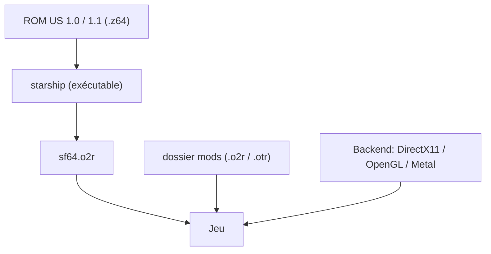

# HarbourMasters/Starship

> A PC port of Star Fox 64, generated from your own copy of the game's ROM.

## The problem
The original game only runs on the Nintendo 64 console, with no graphics options or mods.

## What it actually does
On first launch, the program generates an `sf64.o2r` file from your US ROM (versions 1.0 or 1.1 Rev A). It offers three rendering APIs (DirectX11, OpenGL, Metal), a settings menu and custom assets placed in the `mods` folder. It runs on Windows, Linux, macOS and Nintendo Switch.

## How it is wired
Simplified diagram based on the fiche, no diagram provided.



## Trying it
```bash
chmod +x starship.appimage
./starship.appimage
```

## Cost and gotchas
Free, but you must supply your own ROM: no copyrighted asset is included. The ROM must be in `.z64` format and in a supported US version. In case of a crash, the backend can be changed in `starship.cfg.json`.

## What it is not
It is not a complete game: it does not contain the game's resources. The European and Japanese versions are not used to generate the base assets, only to replace the voices.

## Alternatives
No alternative named in the README.

## For you
Ignore for your line of work: a retro game port unrelated to data, AI or MLOps, of interest only out of curiosity.
