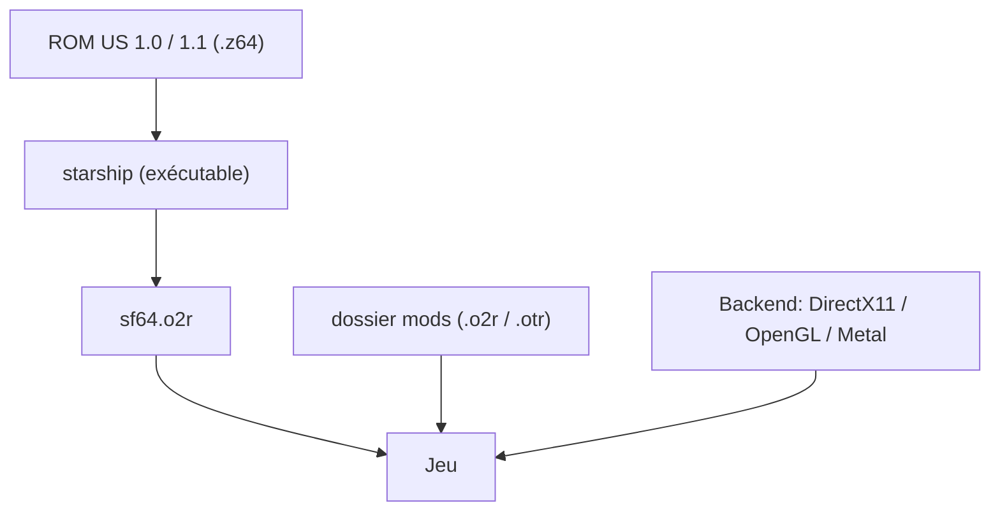

# HarbourMasters/Starship

> Portage PC de Star Fox 64, qui se génère à partir de ta propre ROM du jeu.

## Le problème
Le jeu d'origine ne tourne que sur console Nintendo 64, sans options graphiques ni mods.

## Ce que ça fait vraiment
Au premier lancement, le programme génère un fichier `sf64.o2r` à partir de ta ROM américaine (versions 1.0 ou 1.1 Rev A). Il offre trois API de rendu (DirectX11, OpenGL, Metal), un menu de réglages et des assets personnalisés placés dans le dossier `mods`. Il tourne sur Windows, Linux, macOS et Nintendo Switch.

## Comment c'est branché
Schéma simplifié d'après la fiche, sans diagramme fourni.



## Essayer
```bash
chmod +x starship.appimage
./starship.appimage
```

## Coût et pièges
Gratuit, mais il faut fournir ta propre ROM : aucun asset sous copyright n'est inclus. La ROM doit être au format `.z64` et dans une version américaine supportée. En cas de plantage, le backend se change dans `starship.cfg.json`.

## Ce que ce n'est pas
Ce n'est pas un jeu complet : il ne contient pas les ressources du jeu. Les versions européenne et japonaise ne servent pas à générer les assets de base, seulement à remplacer les voix.

## Alternatives
Aucune alternative nommée dans le README.

## Pour toi
À ignorer pour ton métier : un portage de jeu rétro sans rapport avec data, IA ou MLOps, intéressant seulement par curiosité.

