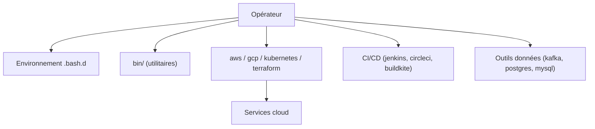

# HariSekhon/DevOps-Bash-tools

> More than 1200 shell scripts and an advanced Bash environment for administrators and DevOps engineers.

## The problem
The same operations tasks (cloud APIs, CI, tool installation, inventories) get rewritten over and over as throwaway scripts.

## What it actually does
A collection of scripts: CLI installation (AWS, Azure, GCloud, Terraform, kubectl, Helm), authenticated API calls, AWS, GCP and Kubernetes inventories, SQL scripts, CI configs, dotfiles (git, vim, tmux), Linux and Mac utilities. The repository mainly targets the command line. The README provided is truncated.

## How it is wired


## Trying it
```bash
curl -L https://git.io/bash-bootstrap | sh
git clone https://github.com/HariSekhon/DevOps-Bash-tools bash-tools
cd bash-tools
make
make install
```

## Cost and gotchas
The bootstrap links dotfiles into `$HOME` (without overwriting existing ones) and installs system packages: read before running. The API scripts require your own tokens.

## What it is not
Not a single tool or a framework: a collection to pick from. Some scripts modify the disk (shred, duplicate removal).

## Alternatives
No alternative named in the README.

## For you
Worth watching: a good reservoir of MLOps/infra scripts to copy, but read and test before any use.
