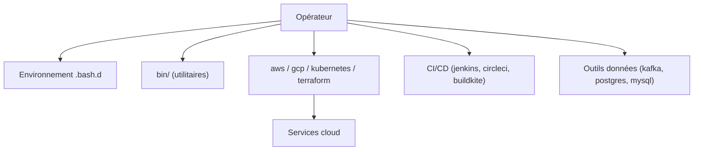

# HariSekhon/DevOps-Bash-tools

> Plus de 1200 scripts shell et un environnement Bash avancé pour administrateurs et ingénieurs DevOps.

## Le problème
Les mêmes tâches d'exploitation (API cloud, CI, installation d'outils, inventaires) se réécrivent sans cesse en scripts jetables.

## Ce que ça fait vraiment
Collection de scripts : installation de CLI (AWS, Azure, GCloud, Terraform, kubectl, Helm), appels d'API authentifiés, inventaires AWS, GCP et Kubernetes, scripts SQL, configs de CI, dotfiles (git, vim, tmux), utilitaires Linux et Mac. Le dépôt vise surtout la ligne de commande. Le README fourni est tronqué.

## Comment c'est branché


## Essayer
```bash
curl -L https://git.io/bash-bootstrap | sh
git clone https://github.com/HariSekhon/DevOps-Bash-tools bash-tools
cd bash-tools
make
make install
```

## Coût et pièges
Le bootstrap lie des dotfiles dans `$HOME` (sans écraser l'existant) et installe des paquets système : lire avant d'exécuter. Les scripts d'API demandent tes propres jetons.

## Ce que ce n'est pas
Pas un outil unique ni un framework : un recueil à piocher. Certains scripts modifient le disque (shred, suppression de doublons).

## Alternatives
Aucune alternative nommée dans le README.

## Pour toi
Surveiller : bon réservoir de scripts MLOps/infra à copier, mais à lire et tester avant tout usage.

