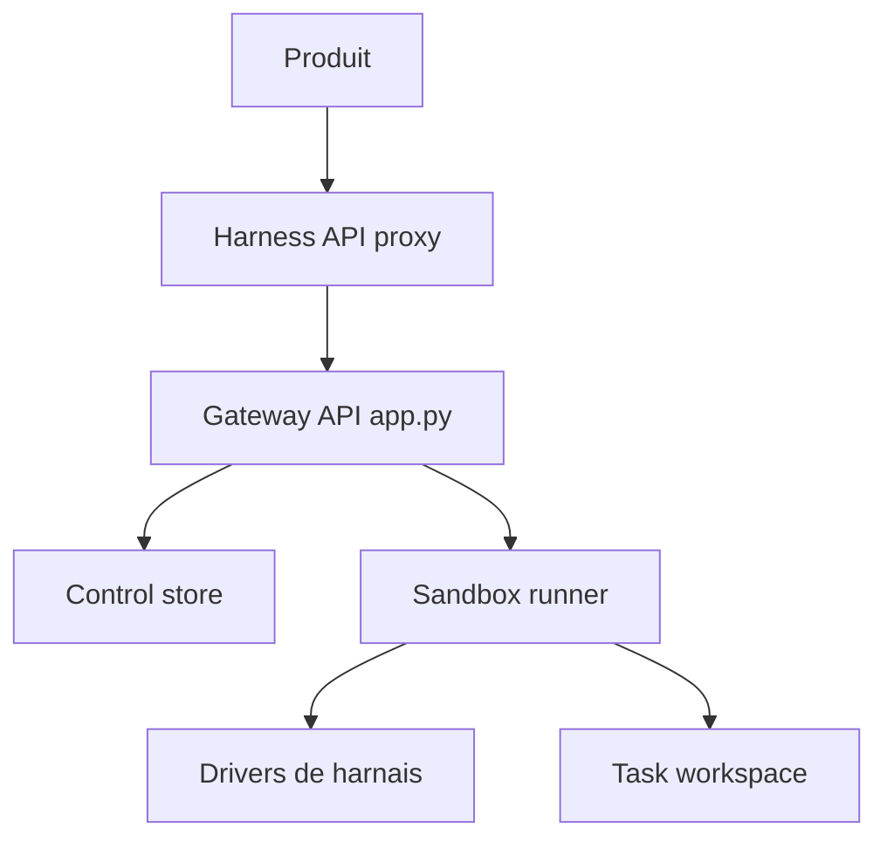

# HarnessRouter/harnessrouter

> Unified gateway to drive Codex, Claude Code and other agent harnesses via an OpenAI Responses-compatible API.

## The problem
Each agent harness has its own interface; integrating several agents into a product requires as many adaptations.

## What it actually does
Implements the Unified Harness Protocol: persistent sessions, streaming, files, cancellation, structured errors. A gateway receives requests, a runner executes turns via drivers in a sandbox. The harness is chosen via `metadata.harness_id`; 30 harnesses listed. Self-hosted community edition or Cloud.

## How it is wired


## Trying it
```bash
docker run -d --name harnessrouter -p 127.0.0.1:3000:3000 -v harnessrouter:/data harnessrouter/harnessrouter
docker logs -f harnessrouter
```

## Cost and gotchas
A model provider key is required, ~4 GB of disk. Default credentials harnessrouter/harnessrouter must be changed. The container must not run with `--user`.

## What it is not
Not a model. The Starter Kits have licenses distinct from the community edition.

## Alternatives
No alternative named.

## For you
Watch: interesting for a backend of interchangeable agents, but young (August 2026).
