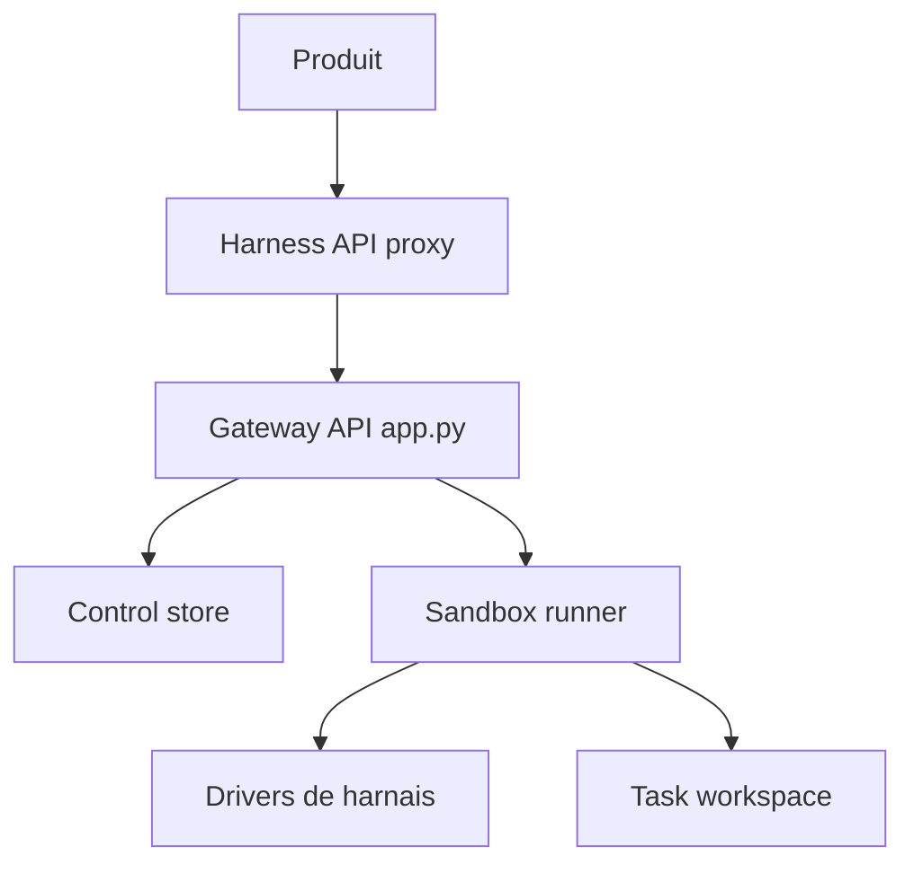

# HarnessRouter/harnessrouter

> Passerelle unifiée pour piloter Codex, Claude Code et d'autres harnais d'agents via une API compatible OpenAI Responses.

## Le problème
Chaque harnais d'agent a sa propre interface ; intégrer plusieurs agents dans un produit demande autant d'adaptations.

## Ce que ça fait vraiment
Implémente le Unified Harness Protocol : sessions persistantes, streaming, fichiers, annulation, erreurs structurées. Une passerelle reçoit les requêtes, un runner exécute les tours via des pilotes dans un bac à sable. Le choix du harnais passe par `metadata.harness_id` ; 30 harnais listés. Édition communautaire auto-hébergée ou Cloud.

## Comment c'est branché


## Essayer
```bash
docker run -d --name harnessrouter -p 127.0.0.1:3000:3000 -v harnessrouter:/data harnessrouter/harnessrouter
docker logs -f harnessrouter
```

## Coût et pièges
Clé de fournisseur de modèle requise, ~4 Go de disque. Identifiants par défaut harnessrouter/harnessrouter à changer. Le conteneur ne doit pas tourner avec `--user`.

## Ce que ce n'est pas
Pas un modèle. Les Starter Kits ont des licences distinctes de l'édition communautaire.

## Alternatives
Aucune alternative nommée.

## Pour toi
Surveiller : intéressant pour un backend d'agents interchangeables, mais jeune (août 2026).

