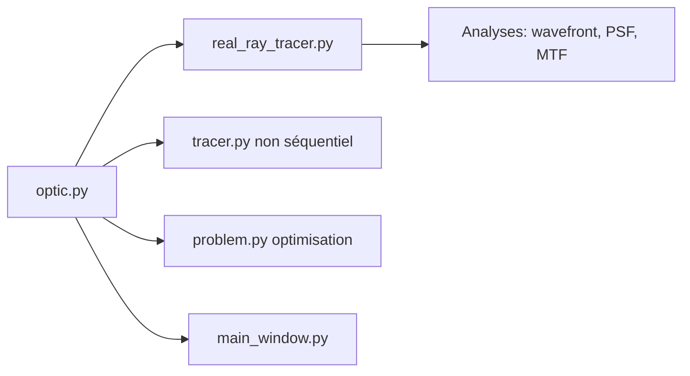

# HarrisonKramer/optiland

> Python optical design platform, differentiable via PyTorch, for optics engineers and researchers.

## The problem
Designing and optimizing lens systems relies on closed software that is hard to script and has no gradients.

## What it actually does
Building refractive and reflective systems, ray tracing, analyses (PSF/MTF, wavefront, Zernike), optimization with merit functions, Monte Carlo tolerancing. Two backends: NumPy (CPU) and PyTorch (GPU, autograd). Zemax, CODE V and OSLO import/export, Matplotlib and VTK visualization, optional GUI. Non-sequential tracing is pre-release.

## How it is wired


## Trying it
```bash
pip install optiland
pip install optiland[gui]
pip install optiland[torch]
```
```python
from optiland.optic import Optic
lens = Optic()
```

## Cost and gotchas
Free. For GPU you have to install a CUDA build of PyTorch yourself. The README states that the code evolves continuously.

## What it is not
Not a machine learning tool: ML is only used to differentiate the physics. The non-sequential and multi-sequence modules are marked pre-release and beta.

## Alternatives
No open source alternative is named in the README.

## For you
Ignore unless you work in optics: outside the usual data/AI scope, even though the differentiable simulation angle is original.
