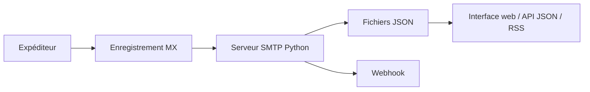

# HaschekSolutions/opentrashmail

> Self-hosted disposable email server, with web interface, JSON API, RSS feed and webhooks.

## The problem
Receiving test or validation emails (2FA) without creating mailboxes, or entrusting your addresses to a public service.

## What it actually does
A Python SMTP server accepts any mail for your domains and stores it as JSON, with no database. Web interface, JSON API, RSS per address, attachments, per-address webhooks (HMAC-SHA256 signature, retries), STARTTLS and direct TLS.

## How it is wired


## Trying it
```bash
docker run -it -p 25:25 -p 80:80 -e URL="https://localhost:80" hascheksolutions/opentrashmail:1
```

## Cost and gotchas
Free, but you need a domain, an MX record and port 25 open to the Internet. Enable `DISCARD_UNKNOWN=true` on a public server so it does not look like an open relay.

## What it is not
Not a mail service nor spam protection. Attachments can reach 20 MB per mail; web access is protected only if you configure `PASSWORD` or `ALLOWED_IPS`.

## Alternatives
No alternative cited in the README.

## For you
Keep an eye on it: handy for automated tests that receive emails, but exposing port 25 requires care.
