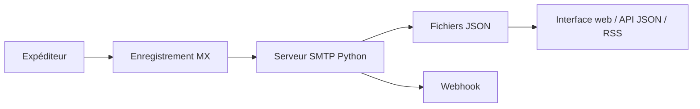

# HaschekSolutions/opentrashmail

> Serveur d'e-mails jetables auto-hébergé, avec interface web, API JSON, flux RSS et webhooks.

## Le problème
Recevoir des mails de test ou de validation (2FA) sans créer de boîtes, ni confier ses adresses à un service public.

## Ce que ça fait vraiment
Un serveur SMTP Python accepte tout mail pour tes domaines et le stocke en JSON, sans base de données. Interface web, API JSON, RSS par adresse, pièces jointes, webhooks par adresse (signature HMAC-SHA256, reprises), STARTTLS et TLS direct.

## Comment c'est branché


## Essayer
```bash
docker run -it -p 25:25 -p 80:80 -e URL="https://localhost:80" hascheksolutions/opentrashmail:1
```

## Coût et pièges
Gratuit, mais il faut un domaine, un enregistrement MX et le port 25 ouvert sur Internet. Activer `DISCARD_UNKNOWN=true` sur un serveur public pour ne pas ressembler à un relais ouvert.

## Ce que ce n'est pas
Pas un service de messagerie ni une protection anti-spam. Les pièces jointes peuvent atteindre 20 Mo par mail ; l'accès web n'est protégé que si tu configures `PASSWORD` ou `ALLOWED_IPS`.

## Alternatives
Aucune alternative citée dans le README.

## Pour toi
Surveiller : pratique pour des tests automatisés qui reçoivent des mails, mais exposer le port 25 demande du soin.

