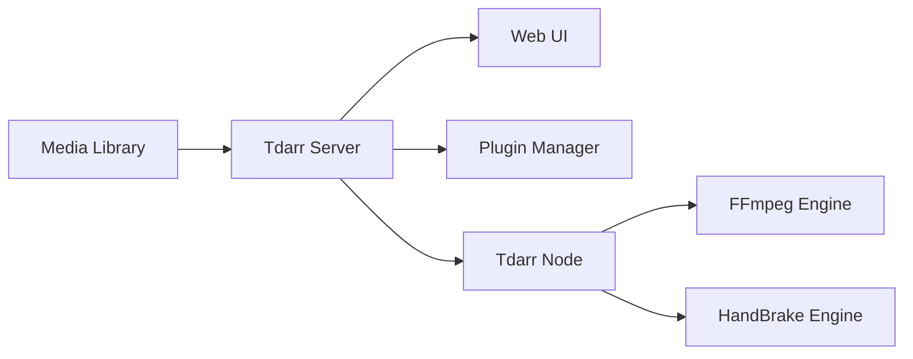

# HaveAGitGat/Tdarr

> Distributed system for automated transcoding and remuxing of audio/video libraries.

## The problem
Standardize codecs, containers and tracks of a large media library (e.g. h264 to h265) without doing it file by file.

## What it actually does
A central server and nodes (Windows, Linux, macOS, ARM) that pick up jobs: CPU/GPU transcoding, health checks. FFmpeg or HandBrake. Rules as a "plugin stack" (JavaScript, filters and actions), 7-day/24-hour scheduler, folder watcher, stall detector. Designed for Sonarr/Radarr.

## How it is wired

## Trying it
No command documented in the README: sites tdarr.io and docs.tdarr.io.

## Cost and gotchas
Free; transcoding is CPU/GPU hungry. License not identified by GitHub. The advertised 40-50% saving depends on the files.

## What it is not
Not a player nor a full media manager: it transforms files.

## Alternatives
HBBatchBeast (desktop version cited in the README).

## For you
Ignore: useful for a personal media library, outside the data/AI scope.
