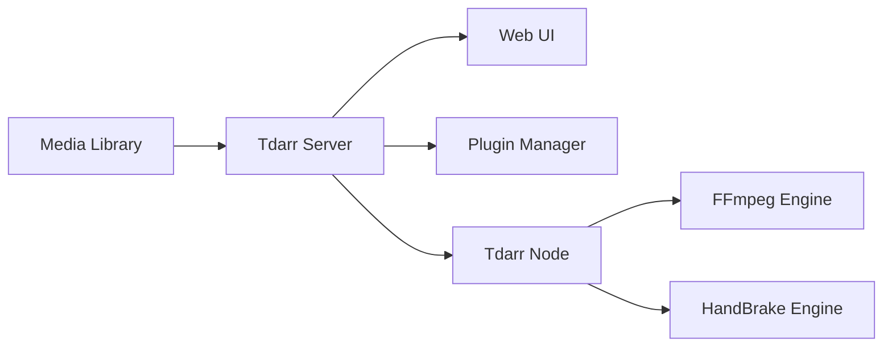

# HaveAGitGat/Tdarr

> Système distribué de transcodage et remux automatisé de bibliothèques audio/vidéo.

## Le problème
Uniformiser codecs, conteneurs et pistes d'une grosse médiathèque (par ex. h264 vers h265) sans le faire fichier par fichier.

## Ce que ça fait vraiment
Un serveur central et des nœuds (Windows, Linux, macOS, ARM) qui prennent des tâches : transcodage CPU/GPU, contrôle de santé. FFmpeg ou HandBrake. Règles en « pile de plugins » (JavaScript, filtres et actions), planificateur 7 j/24, observateur de dossiers, détecteur de blocage. Pensé pour Sonarr/Radarr.

## Comment c'est branché

## Essayer
Aucune commande documentée dans le README : sites tdarr.io et docs.tdarr.io.

## Coût et pièges
Gratuit ; transcodage gourmand en CPU/GPU. Licence non identifiée par GitHub. Le gain de 40–50 % annoncé dépend des fichiers.

## Ce que ce n'est pas
Pas un lecteur ni un gestionnaire de médias complet : il transforme des fichiers.

## Alternatives
HBBatchBeast (version bureau citée dans le README).

## Pour toi
À ignorer : utile pour médiathèque personnelle, hors périmètre data/IA.

