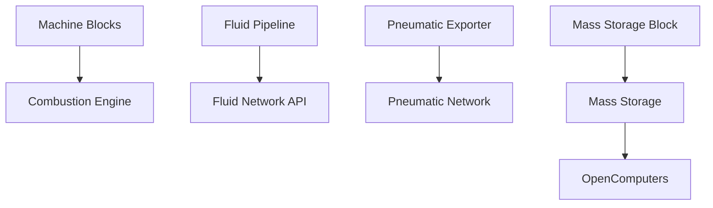

# HbmMods/Hbm-s-Nuclear-Tech-GIT

> Technology, energy and weapons mod for Minecraft 1.7.10, for mod players.

## The problem
Minecraft 1.7.10 lacks advanced machines, logistics, fluids and energy.

## What it actually does
Adds machines, mass storage, fluid piping, pneumatic networks, combustion engines, explosives and the related interfaces. Offers interfaces for OpenComputers and redstone radio. Several behaviors can be disabled through configuration (skybox, world provider, statistics, shortcuts).

## How it is wired


## Trying it
```bash
git clone https://github.com/HbmMods/Hbm-s-Nuclear-Tech-GIT.git
cd Hbm-s-Nuclear-Tech-GIT
./gradlew build
```

## Cost and gotchas
Free. Building requires JDK 8. Known incompatibilities with Thermos (the mod crashes on purpose), Optifine, shaders and Angelica.

## What it is not
Not a general computing tool: a game mod. It is for Minecraft 1.7.10 only.

## Alternatives
No alternative named in the README.

## For you
Ignore: game mod outside your field.
