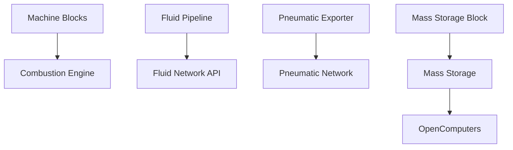

# HbmMods/Hbm-s-Nuclear-Tech-GIT

> Mod de technologie, d'énergie et d'armes pour Minecraft 1.7.10, pour joueurs de mods.

## Le problème
Minecraft 1.7.10 manque de machines, de logistique, de fluides et d'énergie avancés.

## Ce que ça fait vraiment
Ajoute machines, stockage de masse, tuyauteries de fluides, réseaux pneumatiques, moteurs à combustion, explosifs et interfaces associées. Offre des interfaces pour OpenComputers et radio redstone. Plusieurs comportements sont désactivables par configuration (skybox, fournisseur de monde, statistiques, raccourcis).

## Comment c'est branché


## Essayer
```bash
git clone https://github.com/HbmMods/Hbm-s-Nuclear-Tech-GIT.git
cd Hbm-s-Nuclear-Tech-GIT
./gradlew build
```

## Coût et pièges
Gratuit. Compiler demande le JDK 8. Incompatibilités connues avec Thermos (le mod plante exprès), Optifine, les shaders et Angelica.

## Ce que ce n'est pas
Pas un outil informatique général : un mod de jeu. Il est pour Minecraft 1.7.10 uniquement.

## Alternatives
Aucune alternative nommée dans le README.

## Pour toi
À ignorer : mod de jeu hors de ton domaine.

