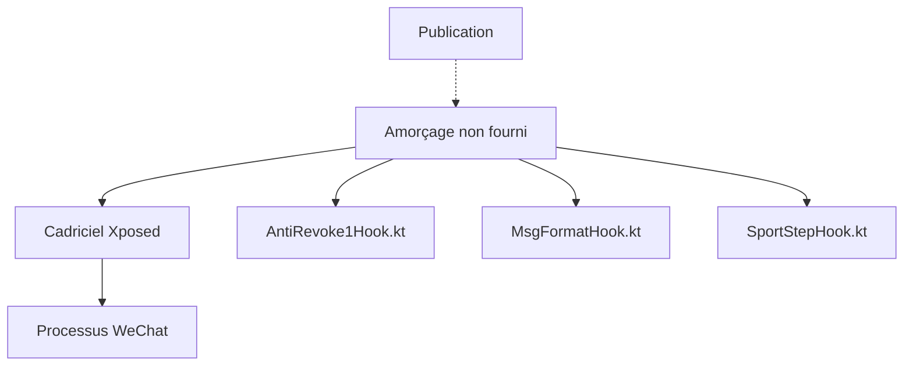

# HdShare/WAuxiliary_Public

> Xposed module for WeChat on Android that modifies the app's behavior, for study purposes.

## The problem
WeChat does not allow certain customizations (keeping recalled messages, skipping steps on photos).

## What it actually does
The module injects hooks into the WeChat process (versions 8.0.44 to 8.0.65). Based on the code: message anti-recall, message formatting, automatic selection of the original photo, removal of ringtones, automatic login, and an isolated "high risk" hook on the step counter. It relies on YukiHookAPI, DexKit and LSPosed.

## How it is wired


## Trying it
```bash
# Aucune commande dans le README : module distribué par versions GitHub et dépôt Xposed.
```

## Cost and gotchas
Free, but you need an Android device with an Xposed environment. The README states: study use only, nothing illegal, and the authors may stop or delete the project at any time. No license declared. The module's bootstrap does not appear in the provided tree.

## What it is not
It is not an official or stable module: it depends on WeChat internals that change. The risks to the account are not documented.

## Alternatives
No alternative named in the README (QAuxiliary is cited in the acknowledgments).

## For you
Ignore: modification of a third-party messaging app, with no license and no link to your field.
