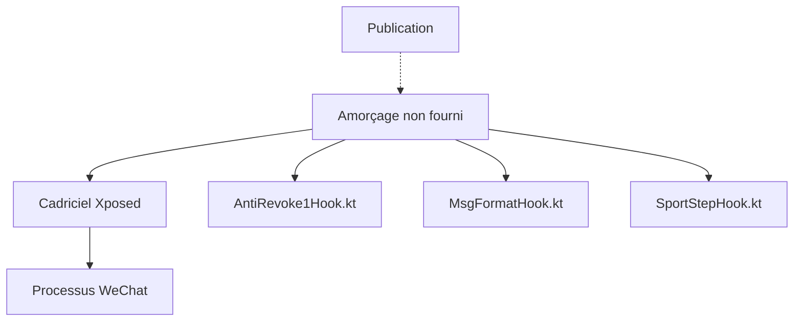

# HdShare/WAuxiliary_Public

> Module Xposed pour WeChat sur Android qui modifie le comportement de l'application, à titre d'étude.

## Le problème
WeChat ne permet pas certaines personnalisations (conserver les messages rappelés, éviter des étapes sur les photos).

## Ce que ça fait vraiment
Le module injecte des crochets dans le processus WeChat (versions 8.0.44 à 8.0.65). D'après le code : anti-rappel de messages, formatage des messages, sélection automatique de la photo originale, suppression de sonneries, connexion automatique, et un crochet isolé « à haut risque » sur le décompte de pas. Il s'appuie sur YukiHookAPI, DexKit et LSPosed.

## Comment c'est branché


## Essayer
```bash
# Aucune commande dans le README : module distribué par versions GitHub et dépôt Xposed.
```

## Coût et pièges
Gratuit, mais il faut un appareil Android avec un environnement Xposed. Le README précise : usage d'étude uniquement, rien d'illégal, et les auteurs peuvent arrêter ou supprimer le projet à tout moment. Aucune licence déclarée. L'amorçage du module n'apparaît pas dans l'arbre fourni.

## Ce que ce n'est pas
Ce n'est pas un module officiel ni stable : il dépend de détails internes de WeChat qui changent. Les risques pour le compte ne sont pas documentés.

## Alternatives
Aucune alternative nommée dans le README (QAuxiliary est cité dans les remerciements).

## Pour toi
À ignorer : modification d'une application de messagerie tierce, sans licence ni lien avec ton métier.

