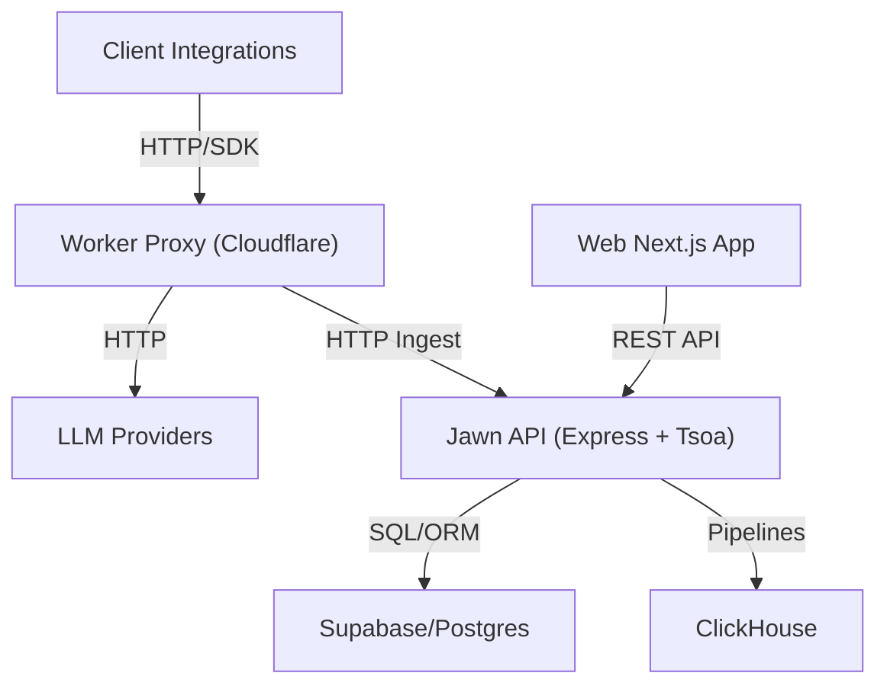

# Helicone/helicone

> LLM API gateway and observability platform for AI engineers: costs, latency, traces, prompts.

## The problem
Without a gateway, you see neither costs nor latency per model, and switching providers or planning a fallback requires changing code.

## What it actually does
You change the `baseURL` of the OpenAI client to `https://ai-gateway.helicone.ai` and get access to over a hundred models with one key, routing and automatic fallbacks. Every request is logged: traces, sessions, costs, datasets, playground, prompt version management. The README announces self-hosting with five services: Web, Worker, Jawn, Supabase, ClickHouse and Minio.

## How it is wired


## Trying it
```bash
git clone https://github.com/Helicone/helicone.git
cd docker
cp .env.example .env
./helicone-compose.sh helicone up
```

## Cost and gotchas
Apache 2.0 license. The hosted version has a free tier of 10,000 requests per month, then you have to buy credits. Model providers are still billed separately. Self-hosting runs five services, including ClickHouse; the Helm chart goes through a sales contact.

## What it is not
It is not an agent orchestrator nor a standalone evaluation tool: it is a proxy that logs. The README notes that the list of integrations may be out of date.

## Alternatives
The README does not name any alternative; it mentions integrations such as LangChain, LlamaIndex and RAGAS.

## For you
Adopt it to track costs and latency of your LLM calls in production: a `baseURL` change is enough, with self-hosting possible.
