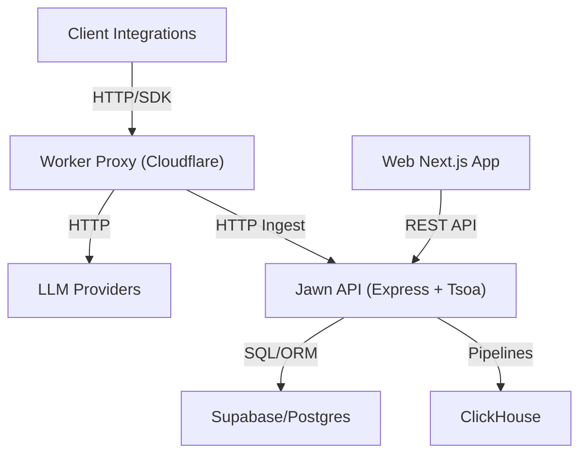

# Helicone/helicone

> Passerelle d'API LLM et plateforme d'observabilité pour ingénieurs IA : coûts, latence, traces, prompts.

## Le problème
Sans passerelle, on ne voit ni les coûts ni la latence par modèle, et changer de fournisseur ou prévoir un repli oblige à modifier le code.

## Ce que ça fait vraiment
On change le `baseURL` du client OpenAI vers `https://ai-gateway.helicone.ai` et on obtient accès à plus de cent modèles avec une clé, un routage et des replis automatiques. Chaque requête est journalisée : traces, sessions, coûts, jeux de données, playground, gestion de versions de prompts. Le README annonce un auto-hébergement avec cinq services : Web, Worker, Jawn, Supabase, ClickHouse et Minio.

## Comment c'est branché


## Essayer
```bash
git clone https://github.com/Helicone/helicone.git
cd docker
cp .env.example .env
./helicone-compose.sh helicone up
```

## Coût et pièges
Licence Apache 2.0. La version hébergée a un palier gratuit de 10 000 requêtes par mois, puis il faut acheter des crédits. Les fournisseurs de modèles restent facturés à part. L'auto-hébergement fait tourner cinq services, dont ClickHouse ; le chart Helm passe par un contact commercial.

## Ce que ce n'est pas
Ce n'est pas un orchestrateur d'agents ni un outil d'évaluation seul : c'est un proxy qui journalise. Le README précise que la liste d'intégrations peut être périmée.

## Alternatives
Le README ne cite pas d'alternative nommée ; il cite des intégrations comme LangChain, LlamaIndex et RAGAS.

## Pour toi
À adopter pour suivre coûts et latence de tes appels LLM en production : un changement de `baseURL` suffit, avec auto-hébergement possible.

