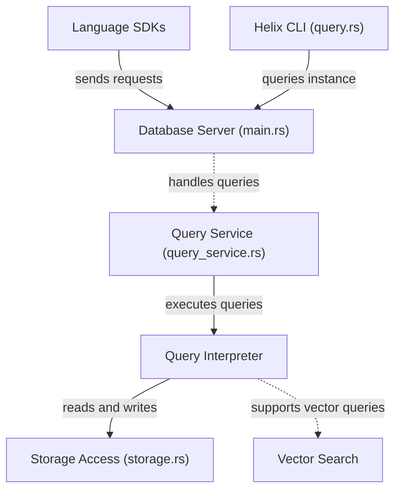

# HelixDB/helix-db

> Graph database in Rust with vector search and BM25 full-text search, for AI application developers.

## The problem
Making a relationship graph, embeddings and text search coexist requires assembling several databases and synchronizing the data.

## What it actually does
A single transactional engine stores entities, relationships, vectors and text on object storage. Queries are written with Rust, TypeScript, Python or Go SDKs and sent to `POST /v2/query` of an instance. The README adds Cypher (reads and CRUD) for source builds, an embedded mode, `helix chef` which launches a coding agent, and Helix Cloud, the managed version.

## How it is wired


## Trying it
```bash
curl -sSL "https://install.helix-db.com" | bash
mkdir my-helix-app && cd my-helix-app
helix init local
helix start dev
helix query dev --file examples/request.json
```

## Cost and gotchas
Apache 2.0 license. The local instance needs Docker or Podman; data is in memory by default and `--disk` persists it. Helix Cloud requires an account and seems paid (prices not stated). Several SDKs are at 0.x versions.

## What it is not
It is not a SQL database: the model is a property graph. Cypher is only available for source builds.

## Alternatives
The README does not name any alternative.

## For you
Worth watching: relevant for RAG that mixes graph, vectors and text, but young and still thinly documented on its limits.
