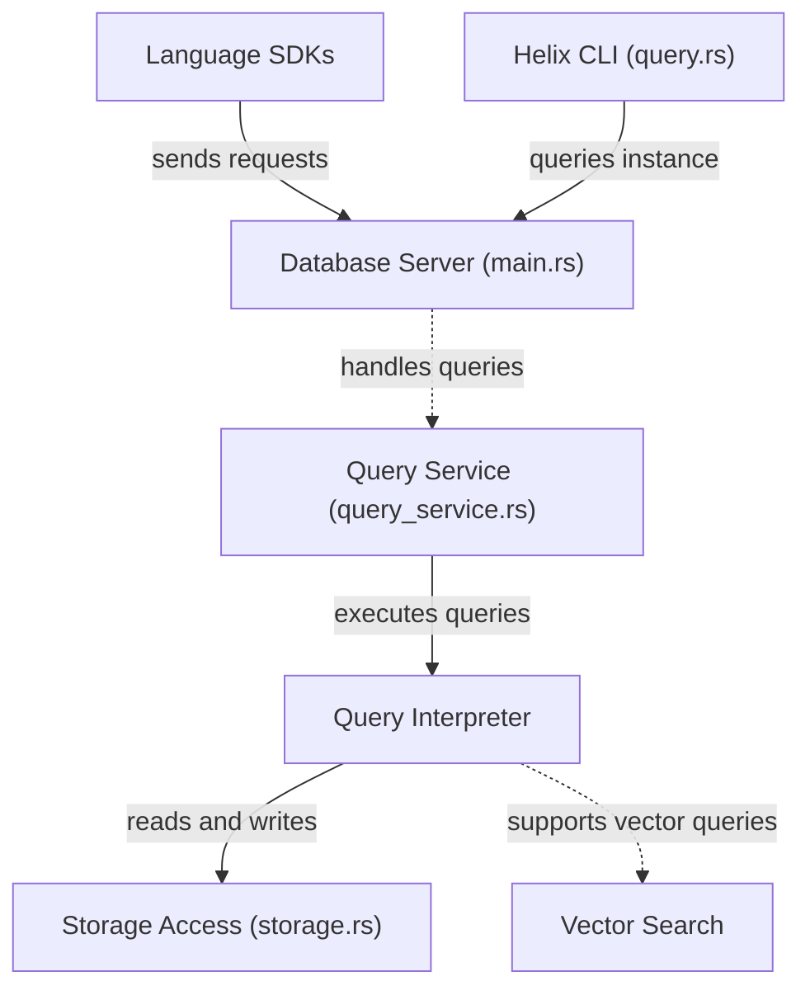

# HelixDB/helix-db

> Base de données graphe en Rust avec recherche vectorielle et plein texte BM25, pour développeurs d'applications IA.

## Le problème
Faire cohabiter graphe de relations, embeddings et recherche textuelle impose d'assembler plusieurs bases et de synchroniser les données.

## Ce que ça fait vraiment
Un moteur transactionnel unique stocke entités, relations, vecteurs et texte sur du stockage objet. Les requêtes s'écrivent avec des SDK Rust, TypeScript, Python ou Go et partent vers `POST /v2/query` d'une instance. Le README ajoute le Cypher (lectures et CRUD) pour les builds source, un mode embarqué, `helix chef` qui lance un agent de code, et Helix Cloud, la version gérée.

## Comment c'est branché


## Essayer
```bash
curl -sSL "https://install.helix-db.com" | bash
mkdir my-helix-app && cd my-helix-app
helix init local
helix start dev
helix query dev --file examples/request.json
```

## Coût et pièges
Licence Apache 2.0. L'instance locale demande Docker ou Podman ; les données sont en mémoire par défaut et `--disk` les persiste. Helix Cloud demande un compte et semble payant (tarifs non indiqués). Plusieurs SDK ont des versions 0.x.

## Ce que ce n'est pas
Ce n'est pas une base SQL : le modèle est un graphe de propriétés. Le Cypher n'est disponible que pour les builds source.

## Alternatives
Le README ne cite pas d'alternative nommée.

## Pour toi
À surveiller : pertinent pour du RAG qui mêle graphe, vecteurs et texte, mais jeune et encore peu documenté sur ses limites.

