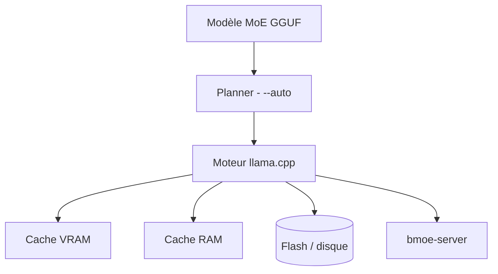

# Helldez/BigMoeOnEdge

> llama.cpp-based engine that runs MoE models larger than memory by reading the experts from disk.

## The problem
MoE models with tens of billions of parameters do not fit in the RAM of a phone or a laptop.

## What it actually does
Keeps the shared weights and the most-used experts in memory, and reads the others from flash, across three tiers (VRAM, RAM, disk). `--auto` measures the machine and chooses cache, threads and the split between CPU, GPU and NPU. Works with any MoE GGUF, on Android, iOS, macOS, Windows and Linux, with CUDA, Metal, Vulkan, HIP and OpenCL. Provides a desktop app, mobile apps, an OpenAI- and Anthropic-compatible server, and a built-in agent.

## How it is wired


## Trying it
```bash
curl -fsSL https://github.com/Helldez/BigMoeOnEdge/releases/latest/download/install.sh | sh
bmoe-cli -m model.gguf --auto -p "Explain MoE routing."
bmoe-cli -m model.gguf --plan
bmoe-server -m model.gguf -c 32768
```

## Cost and gotchas
Free, but models weigh 20 to 90 GB on disk. Measured throughput: 5 to 6 tokens/s for a 35B model on a 12 GB phone, 1 token/s for a 284B. Installing via `curl | sh` requires trusting the script. The macOS build is not notarized, iOS is experimental.

## What it is not
Not new training or quantization: it reads existing GGUFs. The comparison figures against Strata, ds4 or KTransformers are the author's own.

## Alternatives
- Strata: for a Mac with a selection of supported models.
- KTransformers: for an NVIDIA or AMD server, with no phone or laptop.
- colibri: for a format specific to its own engine.

## For you
Worth watching for running large MoEs on limited hardware; the breadth of support and the single maintainer call for caution.
