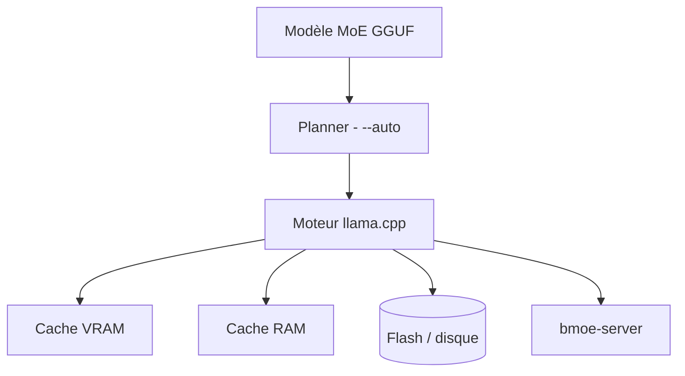

# Helldez/BigMoeOnEdge

> Moteur basé sur llama.cpp qui exécute des modèles MoE plus gros que la mémoire en lisant les experts depuis le disque.

## Le problème
Les modèles MoE de plusieurs dizaines de milliards de paramètres ne tiennent pas dans la RAM d'un téléphone ou d'un portable.

## Ce que ça fait vraiment
Garde en mémoire les poids communs et les experts les plus utilisés, lit les autres depuis la flash, sur trois niveaux (VRAM, RAM, disque). `--auto` mesure la machine et choisit cache, threads et répartition entre CPU, GPU et NPU. Fonctionne avec tout GGUF MoE, sur Android, iOS, macOS, Windows et Linux, avec CUDA, Metal, Vulkan, HIP et OpenCL. Fournit une app de bureau, des apps mobiles, un serveur compatible OpenAI et Anthropic, et un agent intégré.

## Comment c'est branché


## Essayer
```bash
curl -fsSL https://github.com/Helldez/BigMoeOnEdge/releases/latest/download/install.sh | sh
bmoe-cli -m model.gguf --auto -p "Explain MoE routing."
bmoe-cli -m model.gguf --plan
bmoe-server -m model.gguf -c 32768
```

## Coût et pièges
Gratuit, mais les modèles pèsent de 20 à 90 Go sur disque. Débits mesurés : 5 à 6 tokens/s pour un modèle de 35B sur un téléphone de 12 Go, 1 token/s pour un 284B. L'installation par `curl | sh` demande de faire confiance au script. Version macOS non notarisée, iOS expérimental.

## Ce que ce n'est pas
Pas un nouvel entraînement ni une quantification : il lit des GGUF existants. Les chiffres de comparaison avec Strata, ds4 ou KTransformers sont ceux de l'auteur.

## Alternatives
- Strata : pour un Mac avec une sélection de modèles supportés.
- KTransformers : pour un serveur NVIDIA ou AMD, sans téléphone ni portable.
- colibri : pour un format propre à son moteur.

## Pour toi
À surveiller pour faire tourner de gros MoE sur du matériel limité ; l'étendue du support et le mainteneur unique appellent à la prudence.

