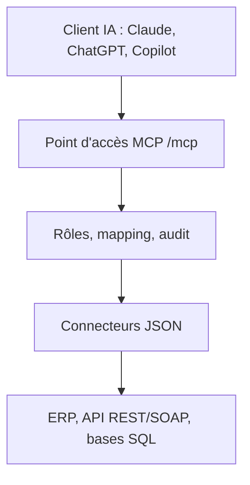

# HelpCode-ai/anythingmcp

> Self-hosted MCP gateway that turns APIs, ERPs and databases into tools for AI clients.

## The problem
Connecting Claude or ChatGPT to ERPs, SOAP APIs or internal databases means writing one MCP server per system.

## What it actually does
A connector is a JSON file: the catalog lists 714 of them, or you can import OpenAPI, SOAP, GraphQL, OData, SQL or IMAP. Operations become MCP tools behind a single endpoint. Roles, per-tool permissions, field filtering and an audit log frame the calls. A knowledge graph, skills and enterprise memory are added on top.

## How it is wired
Simplified diagram based on the sheet, no diagram provided.



## Trying it
```bash
mkdir anythingmcp && cd anythingmcp
curl -fsSLo docker-compose.yml https://raw.githubusercontent.com/HelpCode-ai/anythingmcp/main/docker-compose.quickstart.yml
printf 'JWT_SECRET=%s\nENCRYPTION_KEY=%s\n' "$(openssl rand -hex 32)" "$(openssl rand -hex 32)" > .env
docker compose up -d
```

## Cost and gotchas
Docker 24+ and `openssl`. The community edition is free up to 3 active users; beyond that, SSO, SCIM and memory require Enterprise. Keep `ENCRYPTION_KEY`. amd64 image only. The AI passes use your own key.

## What it is not
Not a simple federation of existing MCP servers. Some connectors are not tested against a real account. The usage figures cited come from the README.

## Alternatives
No alternative cited in the README.

## For you
Worth watching: useful if you need to expose internal systems to agents with governance, but the advanced features are paid.
