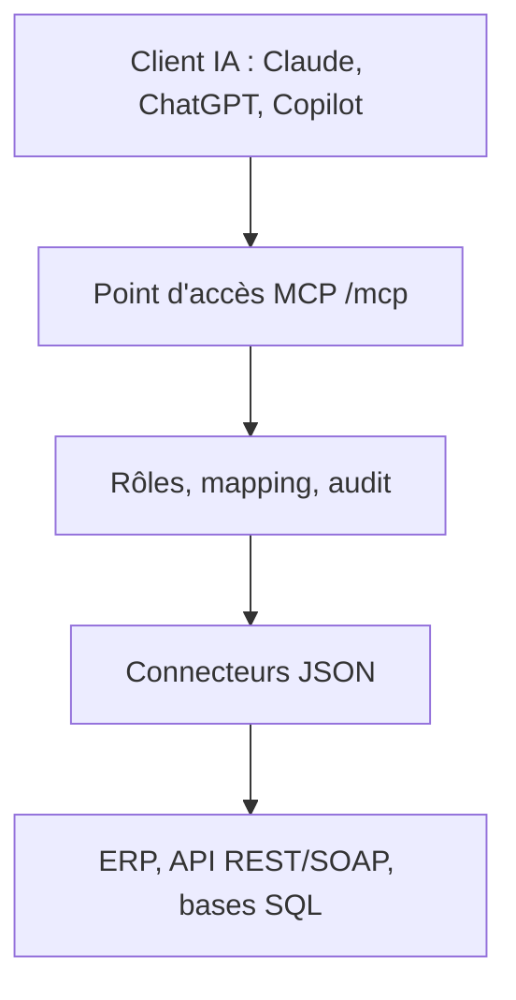

# HelpCode-ai/anythingmcp

> Passerelle MCP auto-hébergée qui transforme API, ERP et bases en outils pour les clients IA.

## Le problème
Brancher Claude ou ChatGPT sur des ERP, des API SOAP ou des bases internes oblige à écrire un serveur MCP par système.

## Ce que ça fait vraiment
Un connecteur est un fichier JSON : le catalogue en annonce 714, ou on importe OpenAPI, SOAP, GraphQL, OData, SQL ou IMAP. Les opérations deviennent des outils MCP sur un seul point d'accès. Rôles, permissions par outil, filtrage des champs et journal d'audit encadrent les appels. Graphe de connaissances, skills et mémoire d'entreprise s'ajoutent.

## Comment c'est branché
Schéma simplifié d'après la fiche, sans diagramme fourni.



## Essayer
```bash
mkdir anythingmcp && cd anythingmcp
curl -fsSLo docker-compose.yml https://raw.githubusercontent.com/HelpCode-ai/anythingmcp/main/docker-compose.quickstart.yml
printf 'JWT_SECRET=%s\nENCRYPTION_KEY=%s\n' "$(openssl rand -hex 32)" "$(openssl rand -hex 32)" > .env
docker compose up -d
```

## Coût et pièges
Docker 24+ et `openssl`. Édition communautaire gratuite jusqu'à 3 utilisateurs actifs ; au-delà, SSO, SCIM et mémoire demandent Enterprise. Conserve `ENCRYPTION_KEY`. Image amd64 seulement. Les passes IA utilisent ta propre clé.

## Ce que ce n'est pas
Pas une simple fédération de serveurs MCP existants. Certains connecteurs ne sont pas testés sur un vrai compte. Les chiffres d'usage cités viennent du README.

## Alternatives
Aucune alternative citée dans le README.

## Pour toi
À surveiller : utile si tu dois exposer des systèmes internes à des agents avec gouvernance, mais les fonctions avancées sont payantes.

