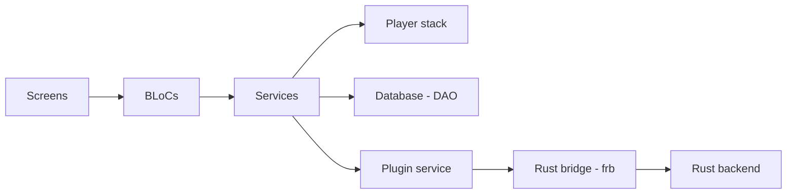

# HemantKArya/BloomeeTunes

> Flutter and Rust music player mixing local files and plugin-provided streams.

## The problem
Listening to your local music and online sources together requires several applications, often with ads.

## What it actually does
Flutter application (BLoC, SQLite DAO) whose plugin engine lives in Rust (`rust/src/api/plugin/`), linked by `flutter_rust_bridge`. Plugins provide content, charts, lyrics and import. Downloads and local-music utilities are in Rust. Integrations: Last.fm, Discord Rich Presence. Supported on Android, Linux, Windows.

## How it is wired

## Trying it
No command in the README (it points to CONTRIBUTING.md and the official sites). Not documented here.

## Cost and gotchas
Free. The README warns against fake sites distributing modified APKs: use only the two official URLs. Since plugins come from third parties, their origin must be checked.

## What it is not
Not a streaming service: the content depends on the plugins. The author calls it "experimental" and says they are a Flutter beginner.

## Alternatives
None named in the README.

## For you
Ignore: a consumer music player, unrelated to data/AI/MLOps.
