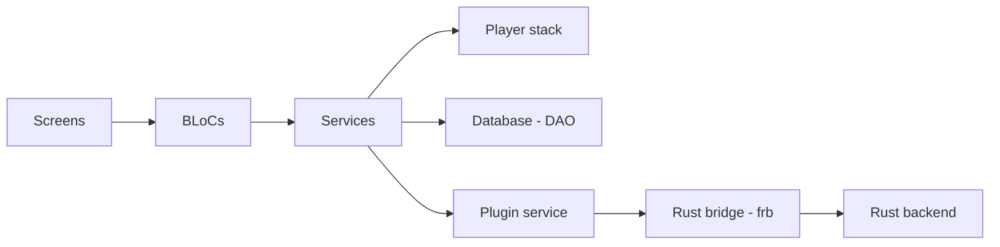

# HemantKArya/BloomeeTunes

> Lecteur de musique Flutter et Rust mêlant fichiers locaux et flux fournis par des plugins.

## Le problème
Écouter ensemble sa musique locale et des sources en ligne exige plusieurs applications, souvent avec publicités.

## Ce que ça fait vraiment
Application Flutter (BLoC, DAO SQLite) dont le moteur de plugins vit dans Rust (`rust/src/api/plugin/`), relié par `flutter_rust_bridge`. Les plugins fournissent contenu, classements, paroles et import. Téléchargements et utilitaires de musique locale sont en Rust. Intégrations : Last.fm, Discord Rich Presence. Supporté Android, Linux, Windows.

## Comment c'est branché

## Essayer
Aucune commande dans le README (il renvoie vers CONTRIBUTING.md et les sites officiels). Non documenté ici.

## Coût et pièges
Gratuit. Le README met en garde contre de faux sites distribuant des APK modifiés : n'utiliser que les deux URL officielles. Les plugins venant de tiers, leur origine est à contrôler.

## Ce que ce n'est pas
Pas un service de streaming : le contenu dépend des plugins. L'auteur le dit « expérimental » et débutant en Flutter.

## Alternatives
Aucune nommée dans le README.

## Pour toi
Ignorer : lecteur de musique grand public, sans lien avec data/IA/MLOps.

