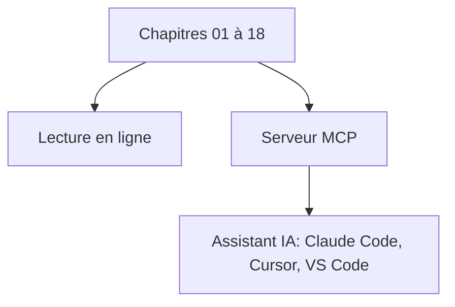

# HenryNdubuaku/maths-cs-ai-compendium

> Free textbook covering maths, computer science and AI, intuition first, for practitioners.

## The problem
Textbooks bury ideas under notation, skip intuition and age quickly in AI.

## What it actually does
Eighteen chapters available: vectors, matrices, calculus, statistics, probability, machine learning, computational linguistics, vision, audio, multimodal, autonomous systems, GNNs, OS, algorithms, software engineering, SIMD and GPU, AI inference, ML system design. An MCP server lets you use the compendium as a knowledge base (local clone required).

## How it is wired

## Trying it
No documented command: read online at henryndubuaku.github.io/maths-cs-ai-compendium. The MCP server requires a local clone; the README does not give the launch command.

## Cost and gotchas
Free. Stated prerequisite level: elementary maths and basic Python. No account required.

## What it is not
Not an interactive course nor a repo of executable code. The content comes from a single author, not peer-reviewed according to the README.

## Alternatives
No alternative named in the README.

## For you
To adopt as a revision reference covering maths, ML, inference and ML system design, all in one place.
