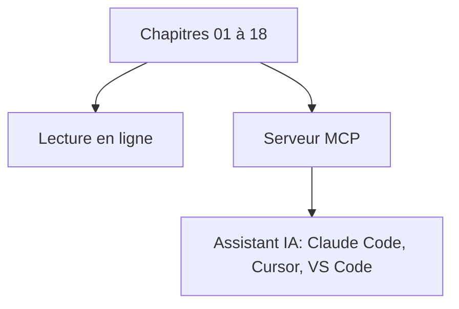

# HenryNdubuaku/maths-cs-ai-compendium

> Manuel libre couvrant maths, informatique et IA, avec l'intuition d'abord, pour praticiens.

## Le problème
Les manuels enterrent les idées sous la notation, sautent l'intuition et vieillissent vite en IA.

## Ce que ça fait vraiment
Dix-huit chapitres disponibles : vecteurs, matrices, calcul, statistiques, probabilités, machine learning, linguistique computationnelle, vision, audio, multimodal, systèmes autonomes, GNN, OS, algorithmique, ingénierie logicielle, SIMD et GPU, inférence IA, conception de systèmes ML. Un serveur MCP permet d'utiliser le compendium comme base de connaissances (clone local requis).

## Comment c'est branché

## Essayer
Aucune commande documentée : lecture en ligne sur henryndubuaku.github.io/maths-cs-ai-compendium. Le serveur MCP exige un clone local ; le README ne donne pas la commande de lancement.

## Coût et pièges
Gratuit. Niveau prérequis annoncé : maths élémentaires et Python de base. Pas de compte requis.

## Ce que ce n'est pas
Pas un cours interactif ni un dépôt de code exécutable. Le contenu est celui d'un auteur unique, non relu par des pairs d'après le README.

## Alternatives
Aucune alternative nommée dans le README.

## Pour toi
À adopter comme référence de révision couvrant maths, ML, inférence et conception de systèmes ML, au même endroit.

