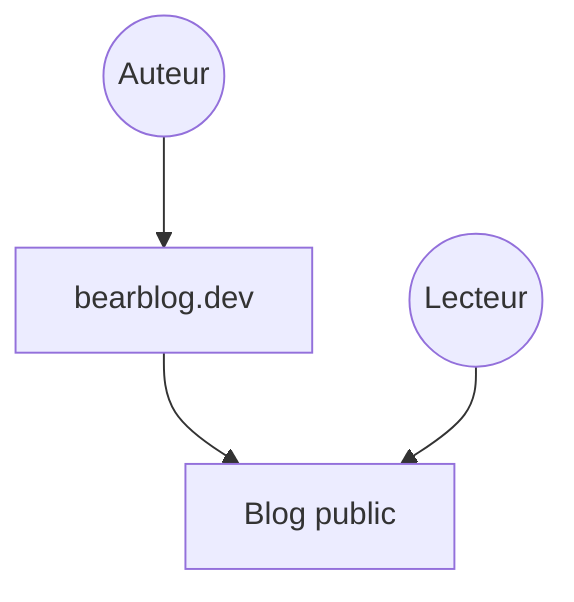

# HermanMartinus/bearblog

> Minimalist, fast, tracker-free blogging platform, hosted at bearblog.dev.

## The problem
Blogging platforms are often heavy and full of trackers.

## What it actually does
The README is very short: it presents a free, simple, tracker-free blog service, with links to the documentation and contributions. Nothing on the architecture or local installation: not documented.

## How it is wired
Simplified diagram based on the sheet, no diagram provided.

## Trying it
No command documented in the README. The indicated path is to create a blog on bearblog.dev, with no installation.

## Cost and gotchas
The README announces a free blog. You must create an account on the service. License present but not identified by GitHub: check before reusing the code.

## What it is not
It is not an AI tool or a self-hosted framework according to the README. The text says nothing about self-hosting.

## Alternatives
No alternative named in the README.

## For you
Ignore: insufficient material and no link with a data/AI profile, unless you simply want a personal blog.
