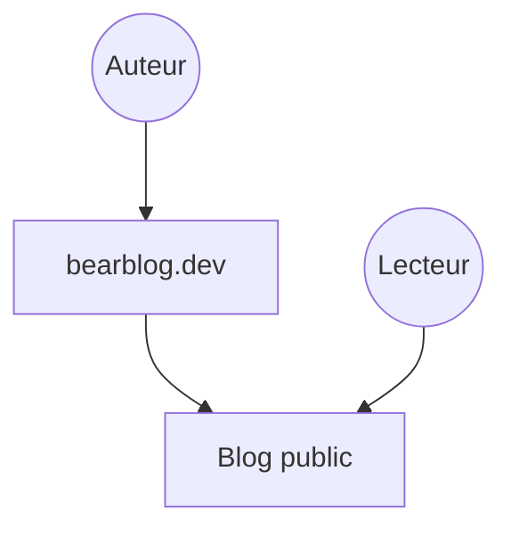

# HermanMartinus/bearblog

> Plateforme de blog minimaliste, rapide et sans traceurs, hébergée sur bearblog.dev.

## Le problème
Les plateformes de blog sont souvent lourdes et pleines de traceurs.

## Ce que ça fait vraiment
Le README est très court : il présente un service de blogs gratuit, simple et sans traceurs, avec des liens vers la documentation et les contributions. Rien sur l'architecture ni l'installation locale : non documenté.

## Comment c'est branché
Schéma simplifié d'après la fiche, sans diagramme fourni.

## Essayer
Aucune commande documentée dans le README. Le chemin indiqué est de créer un blog sur bearblog.dev, sans installation.

## Coût et pièges
Le README annonce un blog gratuit. Il faut créer un compte sur le service. Licence présente mais non identifiée par GitHub : vérifier avant de réutiliser le code.

## Ce que ce n'est pas
Ce n'est pas un outil d'IA ni un framework à héberger soi-même d'après le README. Le texte ne dit rien de l'auto-hébergement.

## Alternatives
Aucune alternative nommée dans le README.

## Pour toi
À ignorer : matière insuffisante et aucun lien avec un profil data/IA, sauf si tu cherches simplement un blog personnel.

