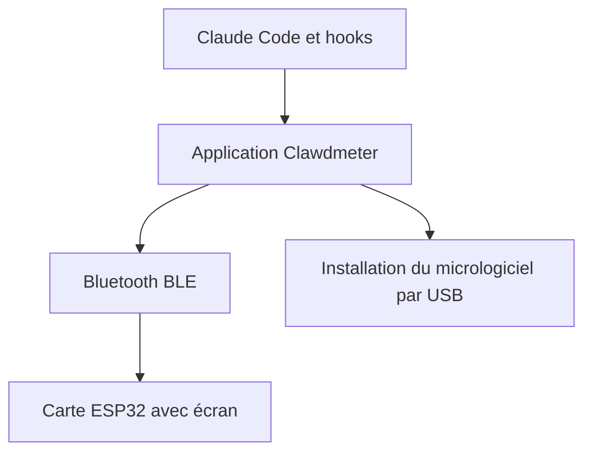

# HermannBjorgvin/Clawdmeter

> ESP32 desk display that shows Claude Code usage limits and reacts to sessions.

## The problem
Tracking your Claude Code usage quotas requires opening a page or running a command, and nothing alerts you when a session is waiting for a reply.

## What it actually does
An application (macOS, Windows, Linux, Nix) that installs the firmware on an ESP32 board with a screen. The board displays the usage gauges, and the Clawd mascot reacts via Claude Code hooks. It pairs over Bluetooth like a keyboard. About twenty boards are supported, from full support to experimental.

## How it is wired
Simplified diagram based on the fiche, no diagram provided.



## Trying it
```bash
sudo apt install ./clawdmeter__amd64.deb
nix run github:HermannBjorgvin/Clawdmeter
```

## Cost and gotchas
Free, but you must buy a compatible ESP32 board. The macOS and Windows packages are not signed. The project is for Claude Code.

## What it is not
Not an open project: no license, and the README admits that proprietary fonts and the protected mascot are used without permission. Do not fork it while ignoring this risk.

## Alternatives
None cited in the README.

## For you
Ignore: an amusing gadget, but with no clear license and with protected assets, so risky to take over.
