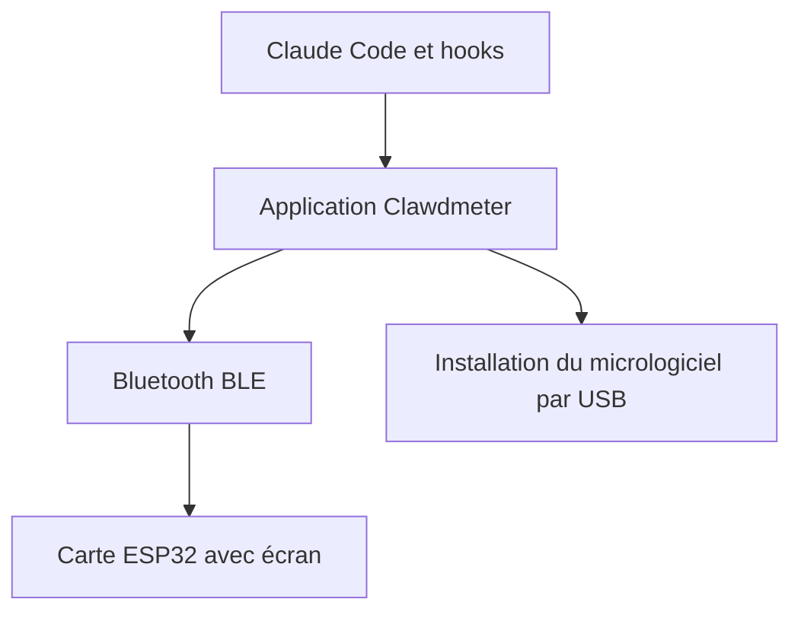

# HermannBjorgvin/Clawdmeter

> Afficheur de bureau ESP32 qui montre les limites d'usage de Claude Code et réagit aux sessions.

## Le problème
Suivre ses quotas d'usage de Claude Code exige d'ouvrir une page ou une commande, et rien n'alerte quand une session attend une réponse.

## Ce que ça fait vraiment
Une application (macOS, Windows, Linux, Nix) qui installe le micrologiciel sur une carte ESP32 avec écran. La carte affiche les jauges d'usage, et la mascotte Clawd réagit via des hooks de Claude Code. Elle se jumelle en Bluetooth comme un clavier. Une vingtaine de cartes sont prises en charge, du plein support à l'expérimental.

## Comment c'est branché
Schéma simplifié d'après la fiche, sans diagramme fourni.



## Essayer
```bash
sudo apt install ./clawdmeter__amd64.deb
nix run github:HermannBjorgvin/Clawdmeter
```

## Coût et pièges
Gratuit, mais il faut acheter une carte ESP32 compatible. Les paquets macOS et Windows ne sont pas signés. Le projet est pour Claude Code.

## Ce que ce n'est pas
Pas un projet libre : aucune licence, et le README avoue des polices propriétaires et la mascotte protégée utilisées sans autorisation. Ne pas forker en ignorant ce risque.

## Alternatives
Aucune citée dans le README.

## Pour toi
À ignorer : gadget amusant, mais sans licence claire et avec des actifs protégés, donc risqué à reprendre.

