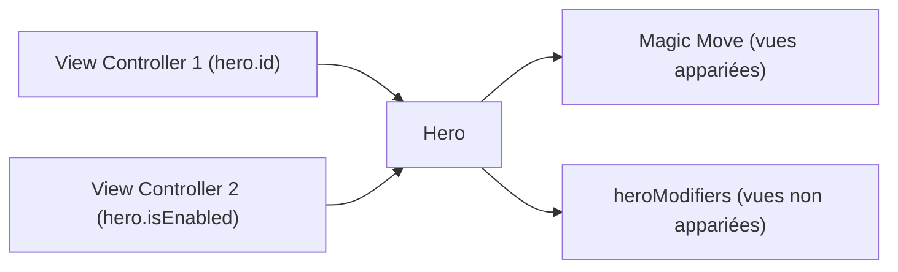

# HeroTransitions/Hero

> iOS library that simplifies transitions between view controllers, in the style of Keynote's Magic Move.

## The problem
UIKit's transitions API is cumbersome to use for custom animations.

## What it actually does
Matches views by `heroID` between two screens and animates each pair from the old state to the new one. Unmatched views get animations through `heroModifiers`. Offers ready-made transitions for modal, navigation and tab bar, controllable by gesture. The duration is computed from the Material Design motion guidelines.

## How it is wired

Simplified diagram based on the fiche, no diagram provided.

## Trying it
```bash
pod install
carthage update
accio update
```
```swift
redView.hero.id = "ironMan"
self.hero.isEnabled = true
```
Add the line `pod 'Hero'` to the Podfile.

## Cost and gotchas
Free, MIT license. Last push in January 2025. Requires iOS, Xcode and Swift, not listed among the plan's prerequisites. `hero.isEnabled` must also be enabled on the navigation controller for a push or pop.

## What it is not
Not an Android or web library. Not a general animation library: it only handles transitions between view controllers.

## Alternatives
No alternative named in the README.

## For you
Ignore: an iOS app development tool, outside the data, AI or MLOps scope.
