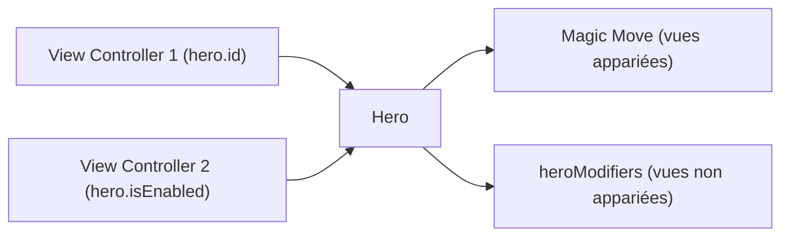

# HeroTransitions/Hero

> Bibliothèque iOS qui simplifie les transitions entre contrôleurs de vue, façon Magic Move de Keynote.

## Le problème
L'API de transitions d'UIKit est lourde à utiliser pour des animations personnalisées.

## Ce que ça fait vraiment
Fait correspondre les vues par `heroID` entre deux écrans et anime chaque paire de l'ancien état vers le nouveau. Les vues non appariées reçoivent des animations via `heroModifiers`. Propose des transitions types pour modal, navigation et barre d'onglets, pilotables par geste. La durée est calculée d'après le guide de mouvement Material Design.

## Comment c'est branché

Schéma simplifié d'après la fiche, sans diagramme fourni.

## Essayer
```bash
pod install
carthage update
accio update
```
```swift
redView.hero.id = "ironMan"
self.hero.isEnabled = true
```
Ligne `pod 'Hero'` à ajouter au Podfile.

## Coût et pièges
Gratuit, licence MIT. Dernier push en janvier 2025. Demande iOS, Xcode et Swift, non listés parmi les prérequis du plan. Il faut activer `hero.isEnabled` aussi sur le contrôleur de navigation pour un push ou pop.

## Ce que ce n'est pas
Pas une bibliothèque Android ni web. Pas une bibliothèque d'animation générale : elle ne traite que les transitions entre contrôleurs de vue.

## Alternatives
Aucune alternative nommée dans le README.

## Pour toi
À ignorer : un outil de développement d'applications iOS, hors du périmètre data, IA ou MLOps.

