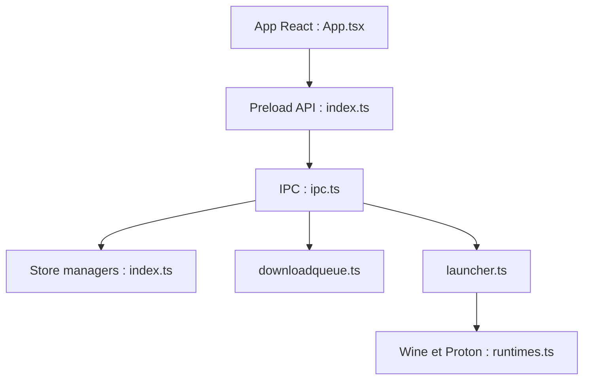

# Heroic-Games-Launcher/HeroicGamesLauncher

> Open source game launcher for the Epic, GOG and Amazon stores, on Linux, Windows and macOS.

## The problem
Official launchers don't always exist on Linux, nor do they bring several stores together.

## What it actually does
Electron (React) application that connects to Epic through Legendary, to GOG through gogdl and to Amazon through Nile. It installs, updates and moves games, launches them via Wine or Proton (Crossover on macOS), manages a download queue and displays ProtonDB information.

## How it is wired


## Trying it
```bash
sudo dpkg -i Heroic*amd64.deb
winget install Heroic
brew install --cask --no-quarantine heroic
pnpm install
pnpm dist:linux
```

## Cost and gotchas
Free. Anti-cheat support depends on the game on Linux and macOS. You need an account on each store.

## What it is not
Not a store: it drives third-party tools. Other stores are only "planned". GPL-3.0 license.

## Alternatives
No alternative cited in the README.

## For you
Ignore: a gaming application unrelated to data, AI or MLOps.
