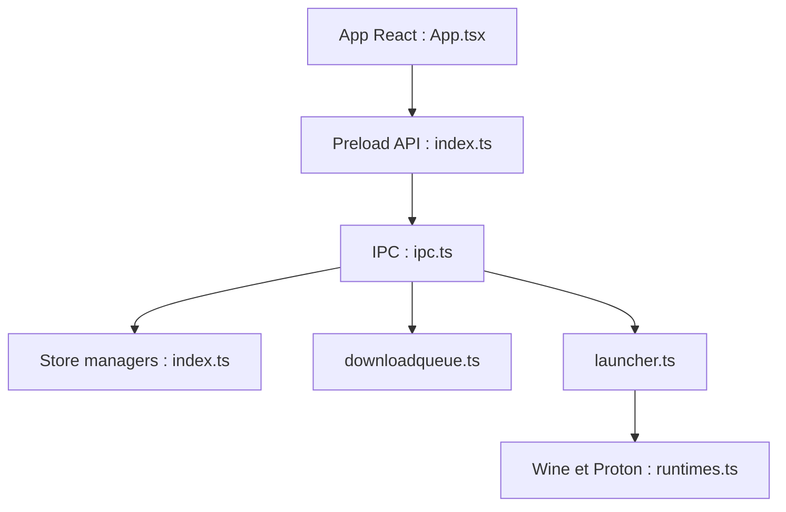

# Heroic-Games-Launcher/HeroicGamesLauncher

> Lanceur de jeux open source pour les boutiques Epic, GOG et Amazon, sur Linux, Windows et macOS.

## Le problème
Les lanceurs officiels n'existent pas toujours sur Linux, ni ne rassemblent plusieurs boutiques.

## Ce que ça fait vraiment
Application Electron (React) qui se connecte à Epic via Legendary, à GOG via gogdl et à Amazon via Nile. Elle installe, met à jour, déplace les jeux, lance via Wine ou Proton (Crossover sur macOS), gère une file de téléchargements et affiche les infos ProtonDB.

## Comment c'est branché


## Essayer
```bash
sudo dpkg -i Heroic*amd64.deb
winget install Heroic
brew install --cask --no-quarantine heroic
pnpm install
pnpm dist:linux
```

## Coût et pièges
Gratuit. Les anti-triche dépendent du jeu sous Linux et macOS. Il faut un compte sur chaque boutique.

## Ce que ce n'est pas
Pas un magasin : il pilote des outils tiers. Autres boutiques seulement « prévues ». Licence GPL-3.0.

## Alternatives
Aucune alternative citée dans le README.

## Pour toi
À ignorer : application de jeu sans rapport avec la data, l'IA ou le MLOps.

