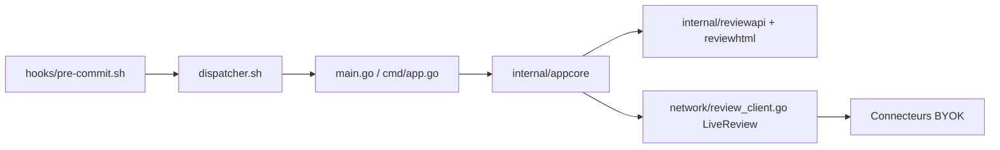

# HexmosTech/git-lrc

> Git hook that runs an AI code review on every commit, for developers who use agents.

## The problem
Code agents remove logic, loosen constraints or leak credentials without saying so; you only find out after the commit.

## What it actually does
The `lrc` binary installs as a global hook and, before each commit, sends the staged diff to a review service, then opens a local interface: diff, per-line comments, an issue browser filtered by severity, a slide-style summary. Decisions (review, `--vouch`, `--skip`, `--agent-mode` in JSON) are recorded in the commit message. Repository rules live in `.lrc/`, with BYOK connectors (OpenAI, Claude, DeepSeek, OpenRouter) and a local risk score.

## How it is wired


## Trying it
```bash
curl -fsSL https://hexmos.com/lrc-install.sh | bash
git lrc setup
git add .
git lrc review
git lrc review --agent-mode
```

## Cost and gotchas
Free up to 30,000 lines per month; Premium starts at $32 for 100,000 lines. You need a Hexmos account and a free Gemini key, or your own keys. Only the staged diff is sent. Installation goes through `curl | bash`.

## What it is not
Not a deterministic review: a model can be wrong. The LiveReview coordination service is hosted by the vendor; self-hosting is reserved for the enterprise offer. License not identified by GitHub.

## Alternatives
LiveReview, the team version from the same vendor.

## For you
Worth watching: handy for reviewing AI-generated code before committing, but it depends on a third-party service and its license needs clarifying.
