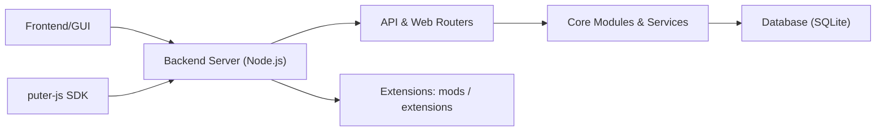

# HeyPuter/puter

> Open-source, self-hostable "internet computer": web desktop, apps and services for developers.

## The problem
Gathering your apps and files in a single web space, or hosting web apps and games with storage and a database, without assembling each service.

## What it actually does
Puter provides a desktop in the browser (notepad, spreadsheet, camera…) and a publishing platform: file cloud, database, workers, AI, an App Store to monetize. According to the architecture: Node.js backend with routers, services and SQLite, `src/gui` interface, puter-js, terminal, emulator, extensions, Docker. Also available as a hosted service on puter.com.

## How it is wired


## Trying it
```bash
git clone https://github.com/HeyPuter/puter
cd puter
npm install
npm start
curl -fsSL https://puter.com/selfhost | sh
```

## Cost and gotchas
Free when self-hosted, served on `puter.localhost:4100`. `curl | sh` runs a remote script: read it first. AGPL-3.0: exposing a modified version over a network requires publishing your code.

## What it is not
Not a data/AI development environment nor an operating system: a web app that imitates a desktop.

## Alternatives
- No alternative named in the README.

## For you
Ignore: it is a general-purpose web desktop under AGPL that brings nothing specific to a data/AI/MLOps workflow.
