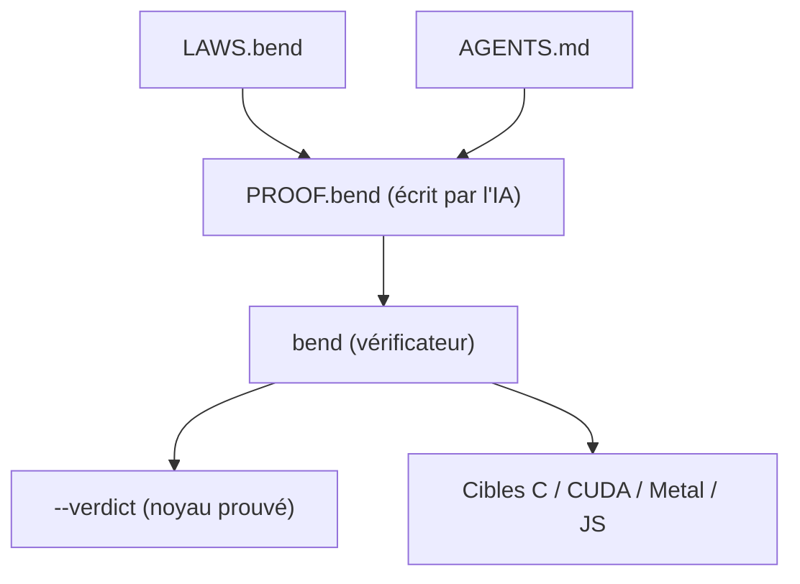

# HigherOrderCO/Bend

> Dependently typed language with proofs, compiled to C, CUDA and Metal, for AI coding agents.

## The problem
Code written by an AI is not reviewed, and nothing guarantees that it respects the project's rules.

## What it actually does
A Python-syntax language with dependent types. A `LAWS.bend` file declares rules, `bend PROOF.bend` asks the agent to prove them at every change. The compiler targets C, Metal, CUDA and JavaScript. Parallelism is declared per call (`pow2!(20n)`). The compiler (outside the kernel) is 99% written by AI and not fully audited, according to the README.

## How it is wired


## Trying it
```bash
curl -fsSL https://bend-lang.com/install.sh | sh
bend guide
bend PROOF.bend
```

## Cost and gotchas
Free. Native binary: clang 14+ (19+ for `!`), Metal or CUDA 12. No Windows (WSL possible). Slow native compilation.

## What it is not
Not the Bend 1 / HVM version: programs do not port over. No HTTP, JSON, regex or test framework. Types annotated everywhere, verbose code, numbers limited to Nat/U32/F32.

## Alternatives
No alternative named in the README.

## For you
Watch: the idea of proven laws to frame an agent is interesting, but the language is young and the library tiny, so there is nothing to build on it for now.
