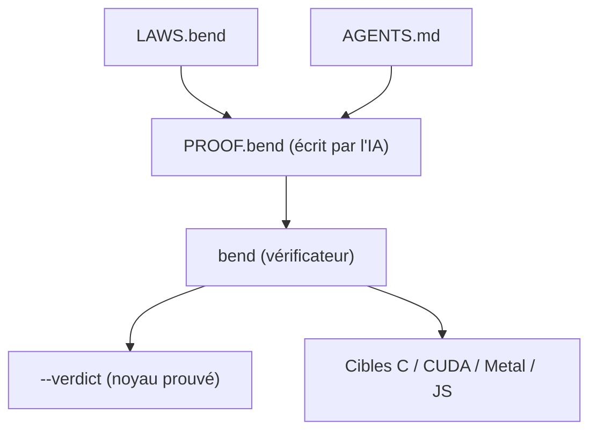

# HigherOrderCO/Bend

> Langage à types dépendants et preuves, compilé vers C, CUDA et Metal, pour agents IA qui codent.

## Le problème
Un code écrit par une IA n'est pas relu, et rien ne garantit qu'il respecte les règles du projet.

## Ce que ça fait vraiment
Un langage syntaxe Python avec types dépendants. Un fichier `LAWS.bend` déclare des règles, `bend PROOF.bend` demande à l'agent de les prouver à chaque modification. Le compilateur cible C, Metal, CUDA et JavaScript. Le parallélisme est déclaré par appel (`pow2!(20n)`). Le compilateur (hors noyau) est écrit à 99 % par IA et pas entièrement audité, d'après le README.

## Comment c'est branché


## Essayer
```bash
curl -fsSL https://bend-lang.com/install.sh | sh
bend guide
bend PROOF.bend
```

## Coût et pièges
Gratuit. Binaire natif : clang 14+ (19+ pour `!`), Metal ou CUDA 12. Pas de Windows (WSL possible). Compilation native lente.

## Ce que ce n'est pas
Pas la version Bend 1 / HVM : les programmes ne se portent pas. Pas de HTTP, JSON, regex ni framework de test. Types annotés partout, code verbeux, nombres limités à Nat/U32/F32.

## Alternatives
Aucune alternative nommée dans le README.

## Pour toi
À surveiller : l'idée de lois prouvées pour cadrer un agent est intéressante, mais le langage est jeune et la bibliothèque minuscule, donc rien à produire dessus pour l'instant.

