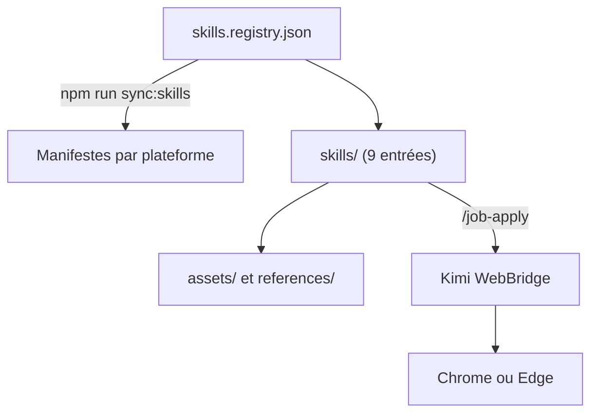

# Hisn00w/ASu-skills

> Plugin of nine Chinese-language skills for job hunting: CV, interviews, application tracking, open source contributions.

## The problem
The job seeker has to chain scattered tasks: finding evidence of experience, tailoring a CV to an offer, preparing interviews and tracking applications.

## What it actually does
Nine commands to call from Claude Code, Codex and other hosts: `/contributor` (open source contributions), `/evidence-recap`, `/project-guide`, `/great-resume`, `/make-resume` (editable HTML, PDF, LaTeX), `/job-match`, `/job-apply` (fills in forms through a browser), `/interview` and `/offer`. The README insists on real facts and forbids inventing experience.

## How it is wired

Simplified diagram based on the sheet, no diagram provided.

## Trying it
```bash
/plugin marketplace add Hisn00w/ASu-skills
/plugin install asu-skills@asu
/reload-plugins
```

## Cost and gotchas
Free, MIT license. `/job-apply` requires a browser extension (Kimi WebBridge or the ChatGPT extension) and that you supply your own credentials and verification codes. The README forbids mass-sending applications.

## What it is not
It is not an AI or data tool: it is a set of coaching prompts in Chinese. It guarantees no hiring result.

## Alternatives
The README mentions SHUAMONE (a revision game for AI roles) as a complement, not a replacement.

## For you
Ignore: everything is in Chinese and aimed at hiring in China, with no link to your data or MLOps work.
